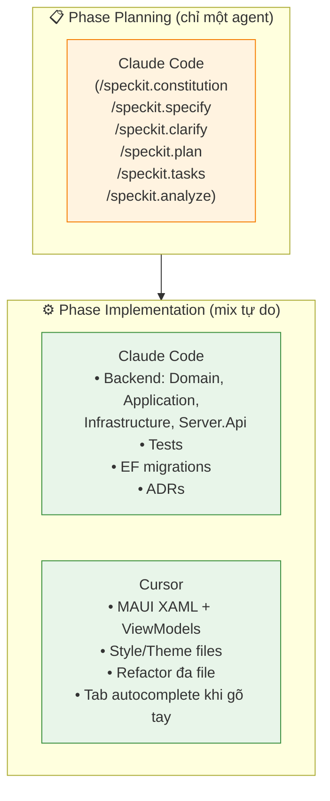
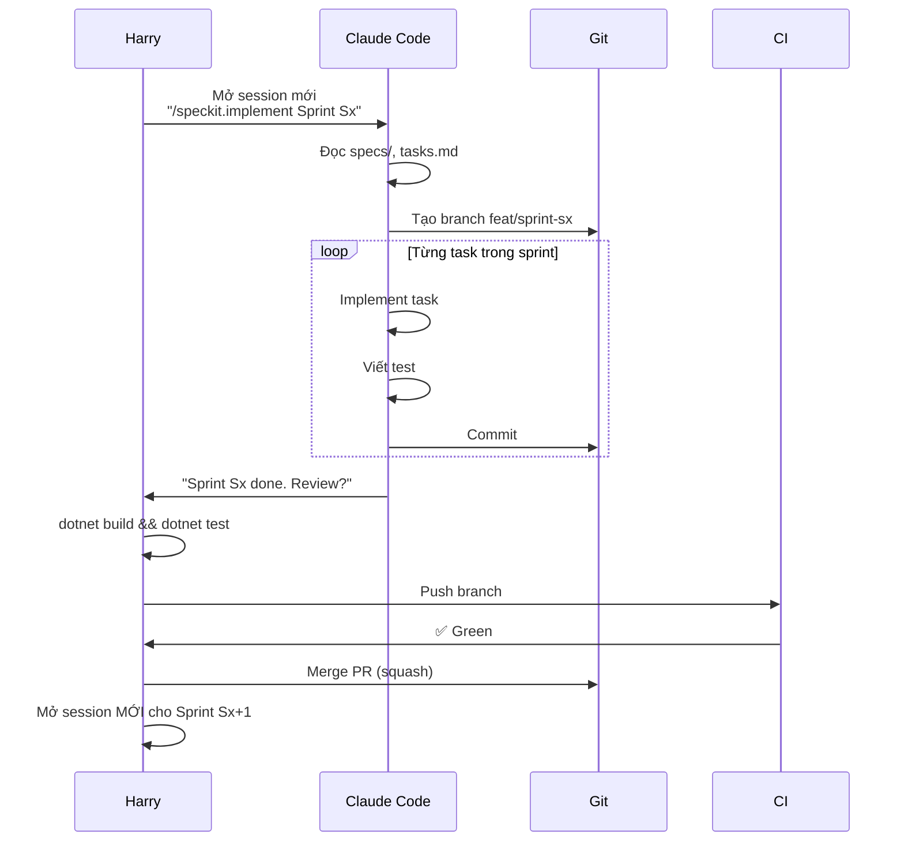
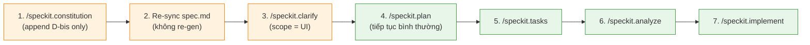

# BOOTSTRAP — Chima Customs B2

> Hướng dẫn end-to-end để đưa project từ "specs viết tay" → "code chạy được" bằng GitHub Spec Kit kết hợp Claude Code và/hoặc Cursor.
>
> **Đọc kèm**: `specs/README.md` (entry point của bộ spec), `prompts.md` (7 prompt template copy-paste).

---

## Mục lục

1. [Yêu cầu hệ thống](#1-yêu-cầu-hệ-thống)
2. [Cài đặt 1 lần](#2-cài-đặt-1-lần)
3. [Khởi tạo Spec Kit](#3-khởi-tạo-spec-kit)
4. [Verify cài đặt](#4-verify-cài-đặt)
5. [Workflow chính — 7 bước](#5-workflow-chính--7-bước)
6. [Kết hợp Claude Code + Cursor](#6-kết-hợp-claude-code--cursor)
7. [Implement theo từng sprint](#7-implement-theo-từng-sprint)
8. [Troubleshooting](#8-troubleshooting)
9. [Phụ lục — Cheat sheet lệnh hay dùng](#9-phụ-lục--cheat-sheet-lệnh-hay-dùng)

---

## 1. Yêu cầu hệ thống

| Công cụ | Phiên bản tối thiểu | Mục đích |
|---|---|---|
| macOS / Windows / Linux | bất kỳ | OS chạy Spec Kit |
| Python | 3.11+ | Spec Kit là Python package |
| `uv` (recommended) hoặc `pipx` | mới nhất | Chạy Spec Kit qua `uvx` |
| `git` | 2.30+ | Version control bắt buộc |
| Claude Code CLI | mới nhất | AI agent chính |
| Cursor (tùy chọn) | mới nhất | AI agent thứ 2 cho UI/refactor |
| .NET 8 SDK | 8.0.x LTS | Build dự án |
| .NET MAUI workload | 8.0.x | Build desktop app |

> **Build target chính của project là Windows**. Nếu Harry dev trên macOS, phần Server.Api/Application/Domain/Tests build tốt; phần `B2.Desktop` (MAUI Windows target) bắt buộc build trên Windows hoặc Windows VM/CI runner.

---

## 2. Cài đặt 1 lần

### 2.1 Cài `uv`

```bash
# macOS
brew install uv

# hoặc cross-platform
curl -LsSf https://astral.sh/uv/install.sh | sh
```

### 2.2 Cài .NET 8 SDK + MAUI workload

```bash
# macOS
brew install --cask dotnet-sdk

# Sau khi có dotnet
dotnet workload install maui
dotnet workload install maui-windows   # bắt buộc nếu dev trên Windows
```

### 2.3 Cài Claude Code CLI

Theo hướng dẫn chính thức tại https://docs.claude.com — sau khi cài, login một lần:
```bash
claude login
```

### 2.4 (Tùy chọn) Cài Cursor

Tải tại https://cursor.com — login và bật Anthropic models.

### 2.5 Verify

```bash
uv --version
python3 --version
git --version
dotnet --version
dotnet workload list
claude --version
```

---

## 3. Khởi tạo Spec Kit

> **QUAN TRỌNG**: Folder `chima-customs/` đã có sẵn `specs/` (4 file Markdown viết tay). Ta dùng `--here` để init Spec Kit **ngay tại folder này**, không tạo subfolder mới.

### 3.1 Khởi tạo git (nếu chưa có)

```bash
cd "/Users/hoanghainh/Claude/System Design/chima-customs"

git init
git add .
git commit -m "chore: handwritten specs baseline"
```

### 3.2 Init Spec Kit cho Claude Code

```bash
cd "/Users/hoanghainh/Claude/System Design/chima-customs"

uvx --from git+https://github.com/github/spec-kit.git specify init --here --integration claude
```

### 3.3 (Nếu muốn dùng cả Cursor) Thêm integration Cursor

```bash
uvx --from git+https://github.com/github/spec-kit.git specify init --here --integration cursor --force
```

> `--force` cho phép ghi đè/cập nhật cấu hình mà không xoá file đã có. Spec Kit sẽ chỉ thêm folder `.cursor/` mà không động vào `.claude/` đã tạo trước đó.

### 3.4 Sau khi init, folder sẽ trông như sau

```
chima-customs/
├── .claude/
│   └── commands/
│       ├── speckit.constitution.md
│       ├── speckit.specify.md
│       ├── speckit.clarify.md
│       ├── speckit.plan.md
│       ├── speckit.tasks.md
│       ├── speckit.analyze.md
│       └── speckit.implement.md
├── .cursor/                          ← chỉ có nếu chạy bước 3.3
│   └── commands/
│       └── (tương tự)
├── .specify/                         ← templates Spec Kit
├── memory/                           ← constitution.md sẽ ở đây
├── specs/                            ← spec viết tay (đã có)
│   ├── README.md
│   ├── 01-overview.md
│   ├── 02-architecture.md
│   ├── 03-functional-spec.md
│   └── 04-implementation-plan.md
├── BOOTSTRAP.md                      ← file này
├── prompts.md                        ← 7 prompt template
├── Định nghĩa yêu cầu.md
├── Business rules - Hướng dẫn điền sổ B2.md
├── Mẫu sổ B2.xlsx
└── Mẫu sổ B2.pdf
```

### 3.5 Pin version (recommend cho production)

Nếu muốn ổn định lâu dài, pin Spec Kit vào một release tag cụ thể (lấy tag mới nhất tại https://github.com/github/spec-kit/releases):

```bash
uvx --from git+https://github.com/github/spec-kit.git@v0.x.y specify init --here --integration claude
```

### 3.6 Commit lại

```bash
git add .
git commit -m "chore: spec-kit init for claude (and cursor)"
```

---

## 4. Verify cài đặt

### 4.1 Trong Claude Code

```bash
cd "/Users/hoanghainh/Claude/System Design/chima-customs"
claude
```

Trong session, gõ `/` → phải thấy 7 commands: `/speckit.constitution`, `/speckit.specify`, `/speckit.clarify`, `/speckit.plan`, `/speckit.tasks`, `/speckit.analyze`, `/speckit.implement`.

### 4.2 Trong Cursor (nếu đã init)

Mở folder `chima-customs/` trong Cursor → mở Composer (`Cmd+I`) → gõ `/` → các slash command tương tự sẽ xuất hiện.

### 4.3 Health check Spec Kit

```bash
uvx --from git+https://github.com/github/spec-kit.git specify check
```

---

## 5. Workflow chính — 7 bước

> Tất cả 7 prompt cụ thể đã soạn sẵn trong `prompts.md`. File này chỉ ghi tổng quan + thứ tự.

```mermaid
flowchart LR
    P1["1️⃣ /speckit.constitution<br/>Nguyên tắc dự án"] --> P2
    P2["2️⃣ /speckit.specify<br/>Bridge spec viết tay"] --> P3
    P3["3️⃣ /speckit.clarify<br/>Làm rõ gap"] --> P4
    P4["4️⃣ /speckit.plan<br/>Tech stack + Architecture"] --> P5
    P5["5️⃣ /speckit.tasks<br/>Sinh task list"] --> P6
    P6["6️⃣ /speckit.analyze<br/>Cross-check artifacts"] --> P7
    P7["7️⃣ /speckit.implement<br/>Code thật, theo sprint"]

    classDef setup fill:#e1f5ff,stroke:#0288d1
    classDef build fill:#e8f5e9,stroke:#388e3c
    class P1,P2,P3,P4 setup
    class P5,P6,P7 build
```



| Bước | Lệnh | Output | Thời gian ước tính |
|---|---|---|---|
| 1 | `/speckit.constitution` | `memory/constitution.md` | 5 phút |
| 2 | `/speckit.specify` | `specs/<branch>/spec.md` | 15 phút (vì có spec viết tay làm input) |
| 3 | `/speckit.clarify` | Q&A trong `spec.md` | 10–20 phút |
| 4 | `/speckit.plan` | `plan.md`, `data-model.md`, `contracts/`, `research.md` | 20 phút |
| 5 | `/speckit.tasks` | `tasks.md` | 10 phút |
| 6 | `/speckit.analyze` | Báo cáo gap | 5 phút |
| 7 | `/speckit.implement` | Code thật, từng sprint | từng sprint 1–3 ngày |

> Sau bước 6 (`/speckit.analyze`), nếu có warning → quay lại sửa spec/plan/tasks tương ứng trước khi sang bước 7.

---

## 6. Kết hợp Claude Code + Cursor

**Câu trả lời ngắn**: Có. Spec Kit hỗ trợ multi-agent — cùng một bộ spec/plan/tasks có thể dùng cho nhiều IDE khác nhau.

### 6.1 Phân chia vai trò khuyến nghị



**Lý do phân vai trò như trên:**

| Tác vụ | Tool tốt hơn | Lý do |
|---|---|---|
| Constitution → Tasks | Claude Code | Long-context tốt hơn cho việc đọc 4 file spec dài |
| Backend code (.cs) | Claude Code | `/speckit.implement` hiểu context spec tốt nhất |
| MAUI XAML | Cursor | Cursor có IntelliSense + tab autocomplete cho XAML mạnh hơn, multi-file edit nhanh |
| Refactor đa file | Cursor | Composer của Cursor tối ưu cho việc này |
| Code review tay | Cursor | Inline diff + chat ngay tại file |
| Chạy test + debug | Claude Code | CLI integration tốt hơn |

### 6.2 Quy tắc tránh xung đột

1. **Một thời điểm chỉ một agent đụng vào một feature**. Nếu Claude Code đang implement F-05, không mở Cursor để sửa cùng F-05.
2. **Commit thường xuyên** — sau mỗi task nhỏ. Đỡ rối khi cần rollback.
3. **`tasks.md` là source of truth chung**. Cả 2 agent đều phải đọc nó trước khi code.
4. **Branch riêng cho từng agent** nếu chạy song song:
   - `feat/F-05-claude` cho Claude Code
   - `feat/F-08-cursor` cho Cursor

### 6.3 Cấu hình Cursor đọc spec đúng cách

Tạo file `.cursorrules` ở root project:

```
Read specs/README.md, then specs/01-overview.md, specs/02-architecture.md, specs/03-functional-spec.md, specs/04-implementation-plan.md before any non-trivial change. Treat the locked tech stack in specs/01-overview.md § 6 as immutable; any deviation requires an ADR under docs/adr/ following specs/04-implementation-plan.md § 9. Use Vietnamese for all user-facing strings via Resources/Strings/AppResources.vi.resx — never hard-code Vietnamese in code.
```

---

## 7. Implement theo từng sprint

> **Khuyến nghị mạnh**: KHÔNG chạy `/speckit.implement` 1 phát cho toàn bộ project. Implement từng sprint một, verify, commit, rồi sang sprint tiếp.

Theo sprint plan trong `specs/04-implementation-plan.md § 2`:

| Sprint | Goal | Features | Recommend tool |
|---|---|---|---|
| **S0** | Bootstrap repo, CI, ADRs | — | Claude Code |
| **S1** | Auth + Master data | F-01, F-02, F-03, F-04 | Claude Code (backend), Cursor (Login UI) |
| **S2** | Entry & exit happy path | F-05, F-06, F-07, F-08 | Claude Code (backend), Cursor (entry/exit form) |
| **S3** | KVGS + ledger + realtime | F-09, F-10 | Claude Code |
| **S4** | Background jobs + reports | F-11, F-12, F-14 | Claude Code |
| **S5** | Export, backup, audit | F-13, F-15, F-16, F-18 | Claude Code |
| **S6** | Hardening, polish, UAT | F-17 + accessibility | Cursor (UI polish) + Claude Code |

### 7.1 Quy trình chuẩn cho mỗi sprint



### 7.2 Kiểm tra sau mỗi sprint

```bash
cd "/Users/hoanghainh/Claude/System Design/chima-customs"

# Format check
dotnet format --verify-no-changes

# Build (release, treat warnings as errors)
dotnet build -c Release /p:TreatWarningsAsErrors=true

# Test
dotnet test -c Release --no-build

# Smoke trên Spec VM (xem specs/04-implementation-plan.md § 8)
# (làm thủ công)
```

### 7.3 Bắt đầu session mới cho mỗi sprint

> **Lý do**: Context window khi `/speckit.implement` 1 sprint sẽ rất nặng (đọc spec, tasks, sinh code, test). Bắt đầu session mới giúp Claude focus, không bị nhiễu bởi sprint trước.

---

## 7.4 Re-sync khi bổ sung wireframe sau /speckit.clarify

> **Tình huống**: Đã chạy đến `/speckit.clarify` → sau đó MỚI bổ sung `specs/05-ui-wireframes.md`. Không cần khởi động lại từ đầu.

Quy trình rút gọn (chi tiết trong `prompts.md` § "Re-sync sau khi bổ sung file wireframe"):



**Kiểm tra trước khi tiếp tục**:
- [ ] `memory/constitution.md` đã có nguyên tắc D-bis về UI Wireframes Binding.
- [ ] `spec.md` (do Spec Kit sinh) đã reference `specs/05-ui-wireframes.md` ở các section liên quan.
- [ ] Section "Clarifications" trong `spec.md` có entry `[UI]` (hoặc dòng "No additional UI clarifications needed").

---

## 8. Troubleshooting

| Triệu chứng | Nguyên nhân thường gặp | Fix |
|---|---|---|
| `specify init` báo "command not found" | Chưa cài `uv` hoặc PATH chưa update | `which uv`, restart shell, hoặc dùng `pipx` thay thế |
| Slash commands không xuất hiện trong Claude Code | Chạy `claude` ở folder khác | `cd` vào đúng folder `chima-customs/` rồi mới `claude` |
| Spec Kit ghi đè lên file cũ | Chạy lại `init` mà không có `--force` | Backup `.claude/`, `.specify/`, `memory/` trước khi chạy lại |
| `dotnet workload install maui` lỗi trên macOS | Thiếu Xcode CLI tools | `xcode-select --install` |
| Build `B2.Desktop` lỗi trên macOS | MAUI Windows target không build trên macOS | Build phần Desktop trên Windows VM hoặc CI runner Windows |
| `/speckit.plan` sinh ra plan khác với spec viết tay | Prompt không đủ chỉ dẫn agent đọc `specs/02-architecture.md` | Dùng đúng prompt trong `prompts.md` |
| `/speckit.implement` đề xuất library không có trong stack đã chốt | Constitution chưa nhấn mạnh ràng buộc | Sửa `memory/constitution.md` thêm rule "no library outside locked stack without ADR" |

---

## 9. Phụ lục — Cheat sheet lệnh hay dùng

### 9.1 Spec Kit

```bash
# Init mới
uvx --from git+https://github.com/github/spec-kit.git specify init --here --integration claude

# Health check
uvx --from git+https://github.com/github/spec-kit.git specify check

# Update Spec Kit lên version mới
uvx --from git+https://github.com/github/spec-kit.git specify init --here --integration claude --force
```

### 9.2 .NET / MAUI

```bash
# Tạo solution + projects (theo specs/04-implementation-plan.md § 3.5)
dotnet new sln -n B2
dotnet new classlib -n B2.Domain -o src/B2.Domain
# ... (xem § 3.5)

# Build
dotnet restore
dotnet build -c Release /p:TreatWarningsAsErrors=true

# Test với coverage
dotnet test -c Release --collect:"XPlat Code Coverage"

# EF Core migration
dotnet ef migrations add InitialCreate -p src/B2.Infrastructure -s src/B2.Server.Service
dotnet ef database update -p src/B2.Infrastructure -s src/B2.Server.Service

# MAUI workload
dotnet workload install maui
dotnet workload list
dotnet workload update
```

### 9.3 Git

```bash
# Branch theo convention dự án
git checkout -b feat/F-05-vehicle-entry

# Commit theo Conventional Commits
git commit -m "feat(F-05): create declaration with first vehicle"

# Squash merge khi PR xong
git checkout main && git merge --squash feat/F-05-vehicle-entry
```

### 9.4 Claude Code

```bash
# Mở session
claude

# Resume session gần nhất
claude --continue

# List sessions
claude --list-sessions
```

---

## Tham chiếu

- [github/spec-kit](https://github.com/github/spec-kit) — toolkit chính chủ
- [Spec Kit installation guide](https://github.com/github/spec-kit/blob/main/docs/installation.md)
- `specs/README.md` — entry point bộ spec
- `specs/04-implementation-plan.md` — sprint plan, repo layout, DoD
- `prompts.md` — 7 prompt template để copy-paste
