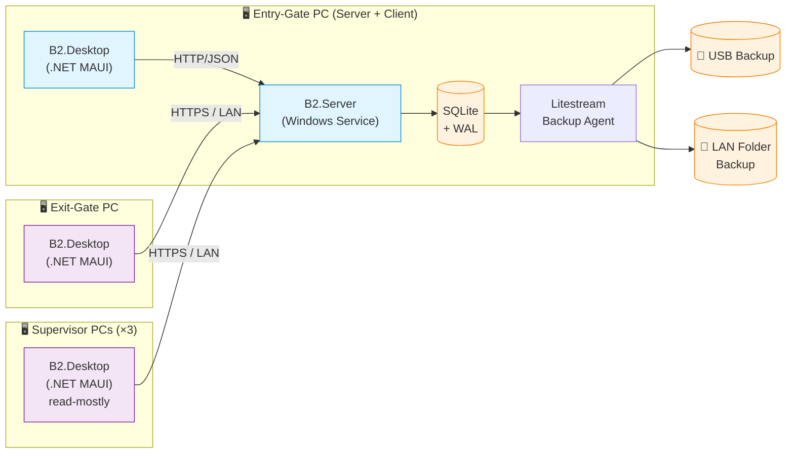

# Chima Customs B2 — System Specification: Overview

> **Audience**: AI coding agents (Claude Code, Cursor, GitHub Spec Kit) and human engineers tasked with implementing this system from scratch.
> **Status**: Approved for implementation — Phase 1 (MVP).
> **Last updated**: 2026-05-03

---

## 1. Problem Framing

The Chima Customs Gate B2 currently manages all vehicle clearance via a single shared Excel file (`Sổ B2`) edited concurrently by the entry gate PC, the exit gate PC, and occasionally supervisor PCs over LAN. This causes:

1. **Concurrency conflicts** between entry and exit gates, leading to lost or inconsistent data.
2. **Excel performance degradation** as the file grows, forcing manual row deletion / backups, breaking data continuity.
3. **No data quality controls** (no master data enforcement, no validation, no audit trail), making mistakes hard to trace.

The system to be built must **eliminate these three root causes** while staying simple enough to be operated by non-IT staff on low-spec Windows 10 PCs disconnected from the internet.

---

## 2. Constraints (immutable)

| # | Constraint | Implication |
|---|------------|-------------|
| C1 | LAN-only, no internet | No cloud, no online package updates at runtime, no OAuth, self-signed TLS only |
| C2 | Hardware: Intel i5-3570 / 4–8 GB RAM / Win 10 64-bit / Office 2010 | Low memory & CPU footprint mandatory; avoid heavy frameworks |
| C3 | No dedicated IT operations team | One-click installer, auto-backup, self-healing, in-app admin tools required |
| C4 | Users prefer desktop apps; intermediate computer literacy | Native desktop UX; avoid web-app patterns; large fonts; keyboard shortcuts |
| C5 | Entry-gate PC = server + client (single machine) | Single Point of Failure accepted; mitigate via continuous backup |
| C6 | Server must run 24/7 (gate operates in shifts) | Background service (auto-start on OS boot), independent of user login |
| C7 | ~5 concurrent users (2 gates + up to 3 supervisor PCs) | SQLite is sufficient; no need for client/server RDBMS |
| C8 | No offline-first requirement on exit/supervisor PCs | When server is down, the system stops. Acceptable per stakeholder. |

---

## 3. Stakeholders & Roles

| Role | Description | Primary screens |
|------|-------------|-----------------|
| **Admin** | Manages users, master data, backups, system config | User mgmt, Master data, Backup/Restore, Audit log |
| **Operator** | Enters vehicle data at entry gate; confirms exits at exit gate | Entry form, Exit confirmation, Search |
| **Supervisor** | Monitors traffic; confirms KVGS; reads reports | Dashboard (read-only), KVGS confirm, Reports |

> RBAC must be enforced **server-side** at the API layer. UI hides unavailable actions but does not rely on UI-only enforcement.

---

## 4. Architecture Direction

**Chosen pattern**: Modular Monolith Client/Server over LAN, with a Background Service running 24/7 on the entry-gate PC.

### Why this pattern (and what was rejected)

| Option | Verdict | Reason |
|--------|---------|--------|
| **A. Modular Monolith C/S + SQLite + .NET MAUI** | ✅ **Chosen** | One installer, low footprint, fast to build, matches stakeholder preference for .NET MAUI |
| B. Microservices | ❌ | Overkill for 5 users, single server, no IT team |
| C. Excel + macros | ❌ | Doesn't solve the root concurrency problem |
| D. P2P sync (CouchDB / PouchDB) | ❌ | Steep learning curve, hard to operate without IT |
| E. Pure web app in browser | ❌ | Poor desktop UX; users dislike browser apps; offline edge cases harder |

### High-level system context

---

## 5. Document Set (read in order)

| # | File | Purpose |
|---|------|---------|
| 01 | `01-overview.md` (this file) | Context, constraints, architecture direction |
| 02 | `02-architecture.md` | Detailed architecture, components, sequence diagrams, ERD |
| 03 | `03-functional-spec.md` | Feature-by-feature spec with acceptance criteria |
| 04 | `04-implementation-plan.md` | Sprint-by-sprint plan, repo layout, coding standards, definition of done |

AI agents implementing this system **must** read all 4 files before generating code. Files 02–04 reference back to constraints in this file by ID (C1, C2, …).

---

## 6. Technology Stack (locked)

| Layer | Technology | Version | Rationale |
|-------|-----------|---------|-----------|
| Desktop UI | **.NET MAUI** | .NET 8 (LTS) | Stakeholder preference; cross-platform option for future |
| UI Toolkit | **CommunityToolkit.Maui** + **CommunityToolkit.Mvvm** | latest stable | MVVM source generators, behaviors |
| UI Theming | **Material design via custom resource dictionaries** (no third-party MAUI material lib is mature enough) | — | Accessibility (WCAG AA), large fonts |
| API Server | **ASP.NET Core 8 Minimal API** | 8.x | Lightweight, fast startup |
| Background jobs | **Quartz.NET** hosted service | 3.x | Cron syntax, persistence optional |
| Realtime push | **SignalR** (LAN) | 8.x | Push exit/KVGS state to other clients |
| ORM | **EF Core 8** + **Microsoft.Data.Sqlite** | 8.x | Mature, repository pattern friendly |
| Database | **SQLite** with `journal_mode=WAL` | 3.45+ | Zero-config, < 1 MB, sufficient for 5 users |
| Continuous backup | **Litestream** | 0.3+ | Replicates WAL to USB / LAN folder |
| Auth | **JWT (RS256)** + **BCrypt.Net-Next** | latest | No external IdP; offline-safe |
| Excel I/O | **ClosedXML** (+ its own dependency **DocumentFormat.OpenXml**, used directly for the streamed annual archive — ADR-0011) | latest | Template-based fill, preserves colors/format |
| Validation | **FluentValidation** | latest | Server-side validation |
| Logging | **Serilog** + rolling file sink | latest | Local log files, viewable in-app |
| HTTP client | **Refit** | latest | Typed API client for the desktop app |
| Resilience | **Polly v8** | 8.x | Retry on transient LAN drops |
| Installer | **Velopack** (preferred) or **Inno Setup** | latest | One-click install + future delta updates from a LAN folder |
| Test framework | **xUnit** + **FluentAssertions** + **Testcontainers** (where applicable) + **bUnit** is N/A; for MAUI use **MAUI Test Harness** | — | — |

> **AI agents**: do not substitute these libraries without an ADR (see `04-implementation-plan.md § ADR process`).

---

## 7. Non-Functional Targets

| Attribute | Target | Verification |
|-----------|--------|--------------|
| Cold app startup | < 5 s on i5-3570 / 4 GB | Manual benchmark on a representative VM |
| Single user action latency (entry/search/exit) | < 200 ms p95 | Load test |
| Concurrent users | 5 sustained, 10 burst | Load test |
| Service uptime | ≥ 99% during operating hours | Self-monitoring health check |
| Restart-after-crash | < 30 s | Windows Service Recovery configured |
| Recovery from latest backup | < 5 min | Drill |
| New-user proficiency | < 15 min to enter a vehicle without training | Usability test (3 users) |
| Accessibility | WCAG 2.1 AA | Audit checklist |

---

## 8. Out of Scope (Phase 1)

- Migration from legacy Excel files (planned as a separate ETL tool — see Phase 2).
- Integration with the unit's internal system (planned via REST in Phase 3 — but the API surface must be designed to accommodate it).
- License plate recognition (LPR) auto-fill.
- Mobile apps.
- Multi-site deployment.

---

## 9. Glossary

| Term | Meaning |
|------|---------|
| **Sổ B2** | The Excel-based vehicle log currently in use at Gate B2 |
| **Tờ khai (Declaration)** | Customs declaration; one declaration covers 1..N vehicles |
| **Dòng cha / Dòng con** | Parent row (declaration) / child rows (vehicles under that declaration) |
| **KVGS** | Khu Vực Giám Sát — supervised area; KVGS confirmation closes a declaration |
| **Người làm thủ tục** | Procedure handler — managed as master data |
| **Tên bãi** | Yard name — managed as master data |
| **Master data** | Reference data pre-entered by Admin (handlers, yards) |
