# Chima Customs B2 — System Specification: Architecture

> Read `01-overview.md` first. Constraint references like (C1), (C5) refer to that file.

---

## 1. Logical Architecture

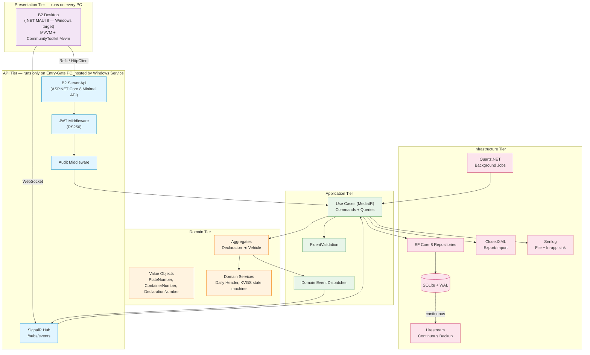

---

## 2. Process & Deployment View

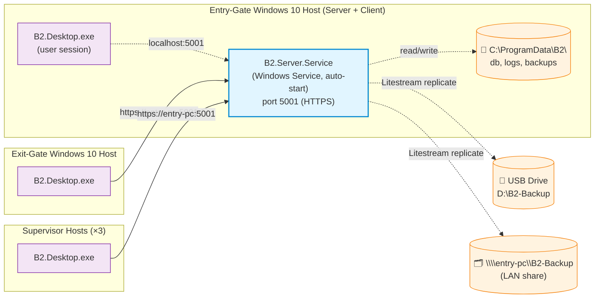

### Host configuration

| Item | Value |
|------|-------|
| Service identity | `LocalSystem` (so it runs without a logged-in user — required by C6) |
| Service recovery | First / Second / Subsequent failure → Restart Service after 30 s |
| Listen address | `https://0.0.0.0:5001` with self-signed cert installed to LocalMachine/Root by installer |
| Firewall rule | Inbound TCP 5001 allowed only on the LAN profile, blocked on Public |
| Data directory | `C:\ProgramData\B2\` (subfolders: `db/`, `logs/`, `backups/`, `keys/`) |
| Permissions on `ProgramData\B2\` | Service account: full control. Authenticated users: read-only on `logs/` |

---

## 3. Project / Solution Layout

```
chima-customs/
└── src/
    ├── B2.Domain/                    # Entities, Value Objects, Domain Services. No EF, no MAUI.
    ├── B2.Application/               # Use cases (MediatR), DTOs, Validators, Interfaces.
    ├── B2.Infrastructure/            # EF Core, Repositories, Quartz jobs, Litestream wrapper, Excel I/O.
    ├── B2.Server.Api/                # ASP.NET Core Minimal API, SignalR Hub, Auth, Audit middleware.
    ├── B2.Server.Service/            # Windows Service host that hosts B2.Server.Api.
    ├── B2.Shared.Contracts/          # DTOs shared between Server and Desktop (no logic).
    ├── B2.Desktop/                   # .NET MAUI app (Windows target only for Phase 1).
    │   ├── Views/                    # XAML pages
    │   ├── ViewModels/               # CommunityToolkit.Mvvm
    │   ├── Services/                 # API client (Refit), Auth state, SignalR client
    │   ├── Resources/                # Styles, colors (WCAG AA), fonts
    │   └── Platforms/Windows/        # Windows-specific entry point
    └── B2.Installer/                 # Velopack config / Inno Setup script
└── tests/
    ├── B2.Domain.Tests/              # xUnit
    ├── B2.Application.Tests/         # xUnit + FluentAssertions
    ├── B2.Server.Api.Tests/          # WebApplicationFactory integration tests
    └── B2.Desktop.Tests/             # MAUI handler tests
└── docs/
    ├── adr/                          # Architecture Decision Records
    └── runbook.md                    # 5-page operator runbook
└── specs/                            # ← THIS DIRECTORY (the docs you are reading)
```

> **AI agents**: respect this layout. New code must be placed in the correct project. Cross-tier references must follow Domain ← Application ← Infrastructure / API; Domain has zero outward dependencies.

---

## 4. Domain Model (ERD)

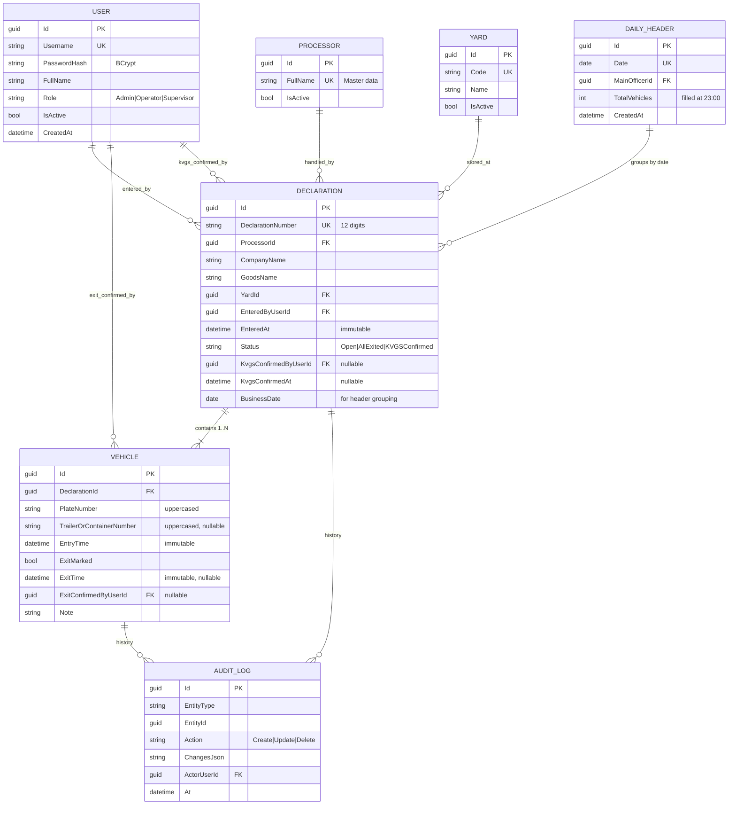

### Aggregate boundaries

- **Declaration** is the aggregate root. **Vehicle** is its child entity. All writes to a vehicle go through its declaration.
- **DailyHeader**, **User**, **Processor**, **Yard** are independent aggregates.
- **AuditLog** is append-only, written by middleware, never modified.

### Invariants enforced in Domain layer

| ID | Invariant | Source |
|----|-----------|--------|
| INV-1 | `DeclarationNumber` is exactly 12 digits and unique among non-cancelled declarations | Business rule cột C + FR-022 |
| INV-2 | `PlateNumber` and `TrailerOrContainerNumber` are stored upper-cased **and separator-stripped** (`29c-12345` → `29C12345`) | Business rule cột E, F |
| INV-3 | `EntryTime` is set on creation by the server clock and is immutable thereafter | Business rule cột I |
| INV-4 | `ExitTime` is set when `ExitMarked` flips false→true and is immutable thereafter | Business rule cột K |
| INV-5 | A declaration becomes `AllExited` automatically when every child vehicle has `ExitMarked=true` | Business rule (dòng cha xanh) |
| INV-6 | `AllExited → KVGSConfirmed` requires the declaration to be `AllExited`; any gate role may confirm (business rule cột L has the exit-gate cán bộ tick it) | Business rule cột L, § B.2 |
| INV-7 | `Processor.FullName` and `Yard.Code` referenced by a Declaration must exist and be active at write time | Business rule cột B, H |
| INV-8 | "Người nhập sổ" and "Người xác nhận" fields are write-once; never editable | Business rule cột M, N |

---

## 5. Key Sequences

### 5.1 Vehicle entry (at Entry Gate)

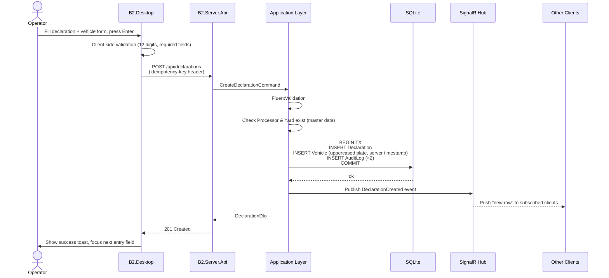

### 5.2 Vehicle exit search & confirmation (at Exit Gate)

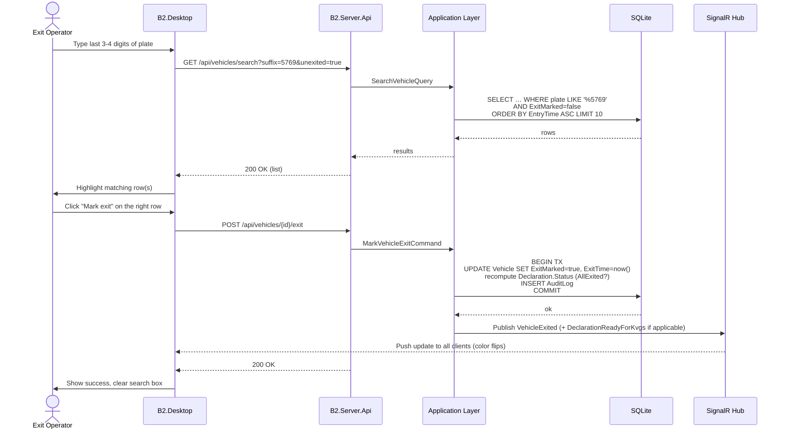

### 5.3 KVGS confirmation (at Supervisor PC)

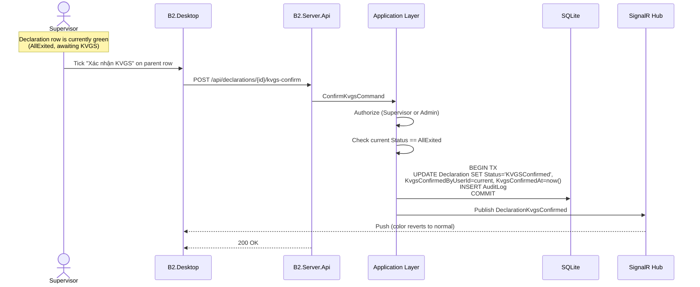

### 5.4 Daily header creation & summary (Background)

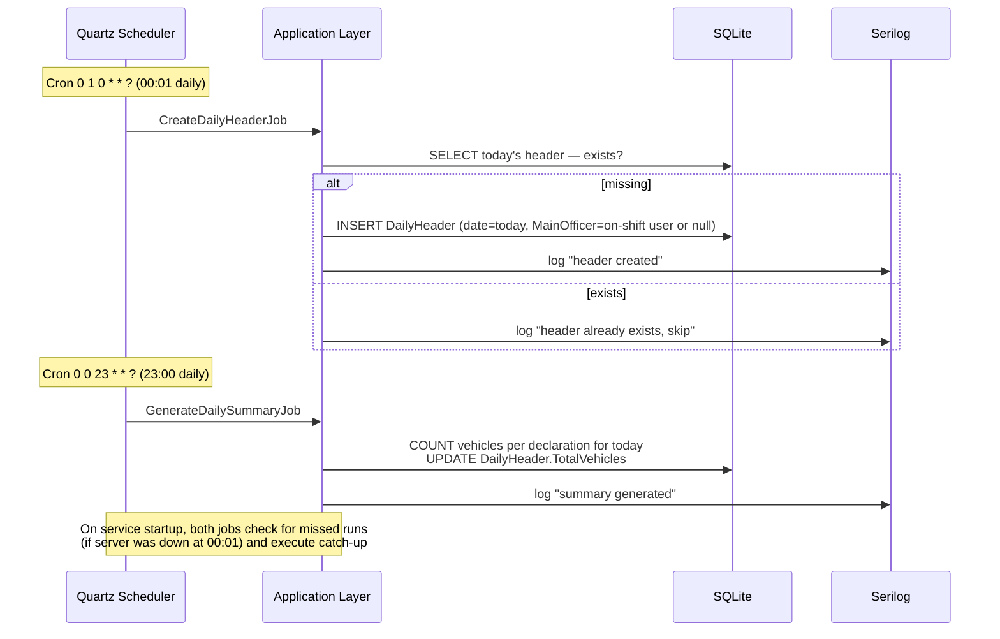

### 5.5 Excel export

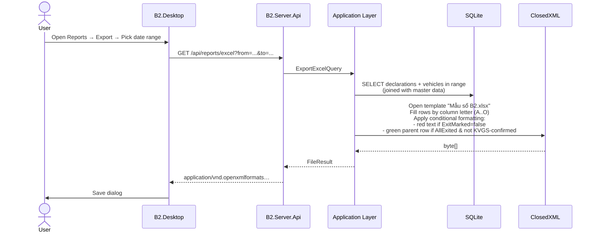

---

## 6. API Surface (locked for Phase 1)

All endpoints are under `/api`. JSON only. JWT in `Authorization: Bearer …` header.

| Method | Path | Auth | Purpose |
|--------|------|------|---------|
| POST | `/api/auth/login` | anonymous | Issue JWT (8 h) + refresh token (7 d) |
| POST | `/api/auth/refresh` | refresh token | Rotate JWT |
| POST | `/api/auth/logout` | any | Revoke refresh token |
| GET | `/api/users` | Admin | List users |
| POST | `/api/users` | Admin | Create user |
| PUT | `/api/users/{id}` | Admin | Update user (name, role, active) |
| POST | `/api/users/{id}/reset-password` | Admin | Reset password |
| GET | `/api/master/processors` | any | List processors |
| POST/PUT/DELETE | `/api/master/processors[/{id}]` | Admin | CRUD |
| GET | `/api/master/yards` | any | List yards |
| POST/PUT/DELETE | `/api/master/yards[/{id}]` | Admin | CRUD |
| GET | `/api/declarations` | any | Paginated list with filters (date, status, plate, processor, yard) |
| POST | `/api/declarations` | Operator+ | Create declaration with initial vehicle(s) |
| GET | `/api/declarations/{id}` | any | Detail + child vehicles |
| POST | `/api/declarations/{id}/vehicles` | Operator+ | Add child vehicle to existing declaration |
| POST | `/api/declarations/{id}/kvgs-confirm` | Supervisor+ | Confirm KVGS |
| GET | `/api/vehicles/search?suffix=…&unexited=…` | any | Search by plate suffix |
| POST | `/api/vehicles/{id}/exit` | Operator+ | Mark exit |
| GET | `/api/reports/by-processor?from=…&to=…` | Supervisor+ | Vehicle count per processor |
| GET | `/api/reports/by-yard?from=…&to=…` | Supervisor+ | Per yard |
| GET | `/api/reports/by-hour?date=…` | Supervisor+ | Per exit hour bucket |
| GET | `/api/reports/by-officer?from=…&to=…` | Supervisor+ | Per entered-by / confirmed-by |
| GET | `/api/reports/pending?asOf=…` | Supervisor+ | Vehicles still inside |
| GET | `/api/reports/excel?from=…&to=…` | Supervisor+ | Template-based Excel |
| GET | `/api/admin/audit?…` | Admin | Read audit log |
| POST | `/api/admin/backup-now` | Admin | Trigger one-shot backup |
| POST | `/api/admin/restore` | Admin (multipart upload) | Restore from a backup file |
| GET | `/api/admin/health` | any | Health check (DB + disk + service uptime) |
| WS | `/hubs/events` | any | SignalR hub for push updates |

> **API stability promise**: paths and DTOs in this list are stable for Phase 1. Breaking changes require an ADR.

---

## 7. State Machines

### Declaration status

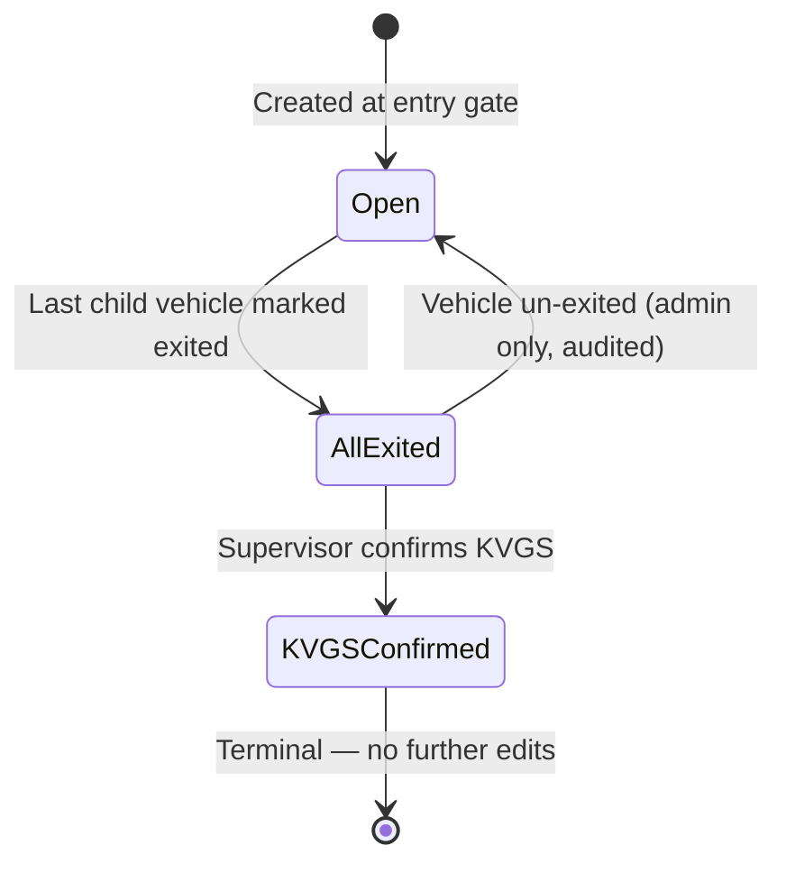

### Vehicle exit flag

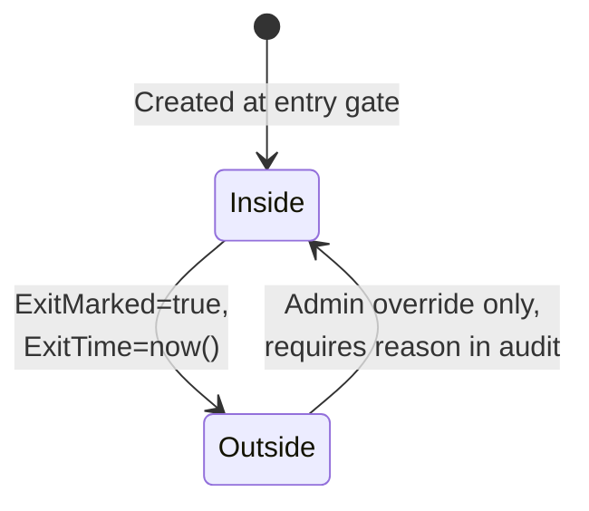

---

## 8. Cross-Cutting Concerns

| Concern | Implementation |
|---------|---------------|
| **Authentication** | JWT RS256. Private key stored in `C:\ProgramData\B2\keys\` protected by Windows DPAPI (per-machine). Tokens 8 h; refresh 7 d. Logout = revoke refresh. |
| **Authorization** | Policy-based (`[Authorize(Policy = "AdminOnly")]`, `"OperatorOrAbove"`, `"SupervisorOrAbove"`). Enforced server-side. |
| **Validation** | FluentValidation on every command. Common rules in `B2.Application/Validation/Common.cs`. |
| **Audit log** | Middleware captures `(actor, action, entity, before, after)` JSON-serialized. Immutable (no UPDATE/DELETE allowed by app). |
| **Logging** | Serilog → file `C:\ProgramData\B2\logs\b2-yyyymmdd.log` (rolling 30 days) + in-memory sink readable by Admin in-app. |
| **Error handling** | `ProblemDetails` per RFC 7807. Domain exceptions mapped to 400/409. Unhandled → 500 + log + correlation id shown to user. |
| **Idempotency** | `POST /api/declarations` and `POST /api/vehicles/{id}/exit` accept `Idempotency-Key` header; server stores last 24 h of keys to dedupe retries from Polly. |
| **Concurrency** | EF Core optimistic concurrency token (`RowVersion BLOB` in SQLite via trigger). 409 on conflict; client refetches and retries. |
| **Time** | All timestamps stored as UTC; UI renders in `Asia/Ho_Chi_Minh`. Format displayed: `dd/MM/yyyy HH:mm`. |
| **i18n** | Vietnamese only for Phase 1. All strings in `Resources/Strings/AppResources.vi.resx`. |
| **Accessibility** | Min font 16 sp; colors meet 4.5:1 contrast (test with axe-style audit); full keyboard navigation; focus rings always visible. |

---

## 9. Backup & Restore Architecture

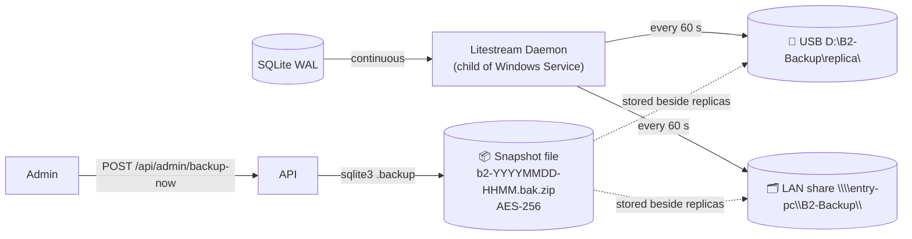

- **Continuous**: Litestream replicates SQLite WAL frames every 60 s.
- **On-demand snapshot**: Admin clicks "Backup now" → API runs `sqlite3 .backup`, zips with AES-256 (password = the one set during install), drops a copy at every configured backup target.
- **Restore**: Admin uploads a snapshot via `POST /api/admin/restore`. Service stops accepting writes → swaps DB file → restarts. Operation logged + audit-trailed.

---

## 10. Risks Tracked at Architecture Level

| Risk | Likelihood | Impact | Mitigation |
|------|-----------|--------|------------|
| Entry-gate PC hardware failure | M | H | Litestream replica on USB + LAN; runbook to spin up replica on a supervisor PC within 30 min |
| SQLite write contention spikes | L | M | WAL mode; benchmark in Sprint 1; migration path to PostgreSQL kept clean (repository pattern) |
| .NET MAUI Windows-target tooling instability | M | M | Pin .NET SDK version; CI build on the same SDK; weekly smoke test on a real low-spec VM |
| Self-signed cert distribution | M | M | Installer pushes cert to LocalMachine/Root on every client during install |
| Background jobs miss schedule (server off) | L | L | Catch-up logic on startup (see § 5.4) |
| Audit log unbounded growth | M | L | Quarterly archive job (Phase 2) |
| Operator forgets backup password | L | H | Password stored sealed in a printed envelope per runbook; escrow procedure documented |
