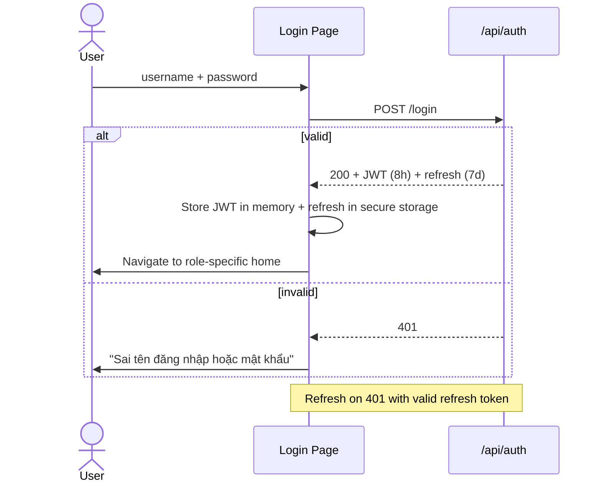

# Chima Customs B2 — System Specification: Functional Spec

> Read `01-overview.md` and `02-architecture.md` first.
> Each feature below has: **purpose, actors, preconditions, flow, acceptance criteria (Gherkin), and references** to business rules.

---

## Feature Index

| ID | Feature | Priority |
|----|---------|----------|
| F-01 | User authentication & session | P0 |
| F-02 | User & role management | P0 |
| F-03 | Master data: Processors | P0 |
| F-04 | Master data: Yards | P0 |
| F-05 | Vehicle entry (Entry Gate) | P0 |
| F-06 | Add child vehicle to existing declaration | P0 |
| F-07 | Vehicle search by plate suffix | P0 |
| F-08 | Mark vehicle exit (Exit Gate) | P0 |
| F-09 | KVGS confirmation | P0 |
| F-10 | List & filter declarations | P0 |
| F-11 | Daily header auto-creation | P0 |
| F-12 | Daily summary auto-generation (23:00) | P0 |
| F-13 | Excel export (template-based) | P0 |
| F-14 | Reports — by processor / yard / hour / officer / pending | P1 |
| F-15 | Backup & restore | P0 |
| F-16 | Audit log viewer | P1 |
| F-17 | Smart suggestions (sticky pairs) | P2 |
| F-18 | In-app log viewer & health status | P1 |

---

## F-01 — User Authentication & Session

**Actors**: Any user.
**Purpose**: Identify users so all writes carry an actor.

### Flow



### Acceptance Criteria

```gherkin
Feature: Login

Scenario: Successful login as Operator
  Given user "nam" with role Operator exists and is active
  When they submit username "nam" and the correct password
  Then they receive a 200 response with a JWT and refresh token
  And the JWT contains claim "role" = "Operator"
  And the JWT lifetime is 8 hours

Scenario: Locked after failures
  Given user "nam" exists
  When they submit a wrong password 5 times within 10 minutes
  Then the account is locked for 15 minutes
  And the 6th attempt returns 423 Locked

Scenario: Auto-logout on idle
  Given a logged-in Operator
  When the desktop app detects no input for 30 minutes
  Then the session is cleared and the login page is shown
```

---

## F-02 — User & Role Management

**Actors**: Admin only.
**Purpose**: Create / update / deactivate user accounts; assign roles.

### Acceptance Criteria

```gherkin
Scenario: Create user
  Given I am Admin
  When I create user "linh" with role "Supervisor" and a temporary password
  Then "linh" appears in the user list as Active
  And on first login "linh" is forced to change password

Scenario: Cannot delete users — only deactivate
  Given user "linh" has 50 audit log entries
  When I try to delete "linh"
  Then deletion is forbidden
  But deactivation is allowed and "linh" can no longer log in

Scenario: Role enforcement on API
  Given I am Operator
  When I call POST /api/users
  Then I receive 403 Forbidden
```

---

## F-03 — Master Data: Processors (Người làm thủ tục)

**Actors**: Admin (write), all users (read).
**References**: Business rule cột B; INV-7.

### Acceptance Criteria

```gherkin
Scenario: Add processor
  Given I am Admin
  When I add processor "Nguyễn Văn Nam"
  Then he appears in the dropdown when entering a declaration

Scenario: Reject unknown processor on entry
  Given processor "Nguyễn Văn Lam" does NOT exist
  When an Operator submits a declaration with processor "Nguyễn Văn Lam"
  Then the API returns 400 with code "MASTER_PROCESSOR_NOT_FOUND"
  And the desktop app shows: "Tên người làm thủ tục không hợp lệ"

Scenario: Deactivate without breaking history
  Given processor "Nam" has 200 historical declarations
  When I deactivate "Nam"
  Then he disappears from new-entry dropdowns
  But existing declarations still show "Nam"
```

---

## F-04 — Master Data: Yards (Tên bãi)

**Actors**: Admin (write), all users (read).
**References**: Business rule cột H.

### Acceptance Criteria

```gherkin
Scenario: Yard code uniqueness
  Given yard with code "QP" exists
  When I add another yard with code "QP"
  Then I receive 409 Conflict

Scenario: Yard appears in entry form
  Given an active yard "QP — Bãi Quân Phục"
  When an Operator opens the entry form
  Then "QP" is in the yard dropdown
```

---

## F-05 — Vehicle Entry (Entry Gate)

**Actors**: Operator at Entry Gate.
**Purpose**: Create a new declaration with its first vehicle in one screen.
**References**: Business rule cột A–H, I; INV-1, INV-2, INV-3, INV-7.

### Form fields

| Field | Type | Validation |
|-------|------|-----------|
| Số tờ khai | text | Exactly 12 digits, unique |
| Người làm thủ tục | dropdown (master) | Required, must be active |
| Tên công ty | text | Required, max 200 |
| Tên hàng | text | Required, max 200 |
| Tên bãi | dropdown (master) | Required, must be active |
| Biển số xe | text | Required; auto-uppercased; pattern `^[0-9]{2}[A-Z]{1,2}[0-9]{4,5}$` |
| Số mooc/container | text | Optional; auto-uppercased |
| Ghi chú | textarea | Optional, max 500 |

### Acceptance Criteria

```gherkin
Scenario: Happy path entry
  Given I am Operator at Entry Gate
  And processor "Nam" and yard "QP" exist
  When I submit a valid declaration with plate "12h05769"
  Then the declaration is created
  And the vehicle's PlateNumber is stored as "12H05769"
  And EntryTime equals the server clock
  And EnteredByUserId equals my user id

Scenario: Duplicate declaration number
  Given declaration "123456789012" already exists
  When I submit another declaration with the same number
  Then the API returns 409 with code "DECLARATION_NUMBER_DUPLICATE"
  And the UI highlights the field in red

Scenario: 12-digit validation
  When I submit declaration number "12345"
  Then the API returns 400 with code "DECLARATION_NUMBER_INVALID"

Scenario: Server timestamp (not client clock)
  Given my client clock is wrong (off by 1 hour)
  When I create an entry at 14:00 server time
  Then EntryTime stored is 14:00 (server time)
```

---

## F-06 — Add Child Vehicle to Existing Declaration

**Actors**: Operator.
**Purpose**: A declaration may cover multiple vehicles entering at different times.

### Acceptance Criteria

```gherkin
Scenario: Add second vehicle to a declaration
  Given declaration "123456789012" exists with 1 vehicle
  When I add a vehicle with plate "29A12345"
  Then the declaration now has 2 vehicles
  And only the first vehicle's row shows the declaration metadata in the UI/Excel
  And subsequent vehicle rows show empty declaration columns (per Sổ B2 layout)

Scenario: Cannot add to KVGS-confirmed declaration
  Given declaration is KVGSConfirmed
  When I add a vehicle to it
  Then the API returns 409 with code "DECLARATION_LOCKED"
```

---

## F-07 — Vehicle Search by Plate Suffix

**Actors**: Any user (primarily Exit Operator).
**References**: Business rule cột P.

### Acceptance Criteria

```gherkin
Scenario: Search returns only un-exited vehicles by default
  Given vehicles with plates "12H05769" (un-exited) and "11H05769" (exited)
  When I search suffix "5769"
  Then only "12H05769" is returned

Scenario: Search 3 or 4 digits
  Given a vehicle "29A12345"
  Then both "2345" and "345" find it

Scenario: Multiple matches
  Given two un-exited vehicles ending in "5769"
  Then both are returned, ordered by EntryTime ascending
  And the UI shows them as a selectable list (no auto-pick)

Scenario: Performance
  Given 50,000 vehicles in DB
  When I search any suffix
  Then results return in < 200 ms p95
  And an index on PlateNumber substring (or generated last-4 column) backs the query
```

---

## F-08 — Mark Vehicle Exit (Exit Gate)

**Actors**: Operator at Exit Gate.
**References**: Business rule cột J, K; INV-4, INV-5.

### Acceptance Criteria

```gherkin
Scenario: Mark exit
  Given vehicle "12H05769" is inside
  When I mark its exit
  Then ExitMarked = true, ExitTime = server clock
  And the row text turns black (was red)
  And ExitConfirmedByUserId = my user id

Scenario: Auto-promote declaration to AllExited
  Given declaration with 3 vehicles, 2 already exited
  When I mark the 3rd exit
  Then declaration.Status flips to "AllExited"
  And the parent row turns green in all clients
  And a SignalR event "DeclarationReadyForKvgs" is broadcast

Scenario: Idempotent retry
  Given a Polly retry sends the same exit twice with the same Idempotency-Key
  Then the second call returns the same result as the first
  And only one AuditLog entry is written

Scenario: Cannot un-exit (Operator)
  Given a vehicle is already exited
  When an Operator tries to mark it again
  Then the API returns 409 with code "VEHICLE_ALREADY_EXITED"

Scenario: Admin un-exit override
  Given I am Admin
  When I call POST /api/vehicles/{id}/un-exit with reason "wrong vehicle"
  Then ExitMarked = false, ExitTime = null
  And AuditLog stores the reason
```

---

## F-09 — KVGS Confirmation

**Actors**: Supervisor or Admin.
**References**: Business rule cột L; INV-6.

### Acceptance Criteria

```gherkin
Scenario: Confirm KVGS
  Given declaration is in status "AllExited"
  When I (Supervisor) confirm KVGS
  Then status flips to "KVGSConfirmed"
  And KvgsConfirmedByUserId = my user id, KvgsConfirmedAt = server clock
  And the parent row reverts to normal color
  And the row becomes read-only for everyone (Operators cannot add vehicles)

Scenario: Operator cannot confirm
  Given I am Operator
  When I try to confirm KVGS
  Then the API returns 403

Scenario: Cannot confirm before AllExited
  Given declaration is in status "Open"
  When I try to confirm KVGS
  Then the API returns 409 with code "DECLARATION_NOT_READY_FOR_KVGS"
```

---

## F-10 — List & Filter Declarations

**Actors**: Any user.
**Purpose**: The main "ledger view" — replicates the Excel rolling list.

### Filters

- Date range (default: today)
- Status (Open / AllExited / KVGSConfirmed / All)
- Plate (full or suffix)
- Processor (multi-select)
- Yard (multi-select)
- Officer (entered by / confirmed by)

### Acceptance Criteria

```gherkin
Scenario: Default view shows today, newest first
  Given declarations exist across multiple days
  When I open the ledger
  Then I see today's declarations only
  And ordered by EntryTime desc

Scenario: Live updates via SignalR
  Given I am viewing the ledger
  When another user creates / exits / KVGS-confirms a declaration
  Then my view updates within 1 second without refresh
  And no full refetch happens (delta updates only)

Scenario: Pagination
  Given 1000 declarations match my filter
  Then they paginate at 50/page
  And jumping to page 20 returns in < 300 ms
```

---

## F-11 — Daily Header Auto-Creation

**Actors**: System (Quartz job).
**References**: Business rule note "00h01 mỗi ngày".

### Acceptance Criteria

```gherkin
Scenario: Header created at 00:01
  Given today is a new day
  When the clock hits 00:01
  Then a DailyHeader record exists for today
  And it appears as the first row in the ledger / Excel export

Scenario: Catch-up on startup
  Given the server was off at 00:01 and started at 06:30
  When the service starts
  Then the missing DailyHeader is created immediately for today

Scenario: Idempotent
  When the job runs twice the same day
  Then only one DailyHeader exists for that date
```

---

## F-12 — Daily Summary Auto-Generation (23:00)

**Actors**: System.
**References**: Business rule note "tổng kết vào hồi 23h00".

### Acceptance Criteria

```gherkin
Scenario: Summary at 23:00
  Given declarations and vehicles exist for today
  When the clock hits 23:00
  Then DailyHeader.TotalVehicles = COUNT(vehicles entered today)
  And the row's "summary" cell is populated

Scenario: Re-run on demand
  Given an Admin clicks "Recompute today's summary"
  Then the summary recomputes immediately
  And an audit log entry records who triggered it
```

---

## F-13 — Excel Export (Template-Based)

**Actors**: Supervisor / Admin.
**References**: Business rule "kết xuất dữ liệu ra dạng excel".

### Behavior

- Template: `Mẫu sổ B2.xlsx` (shipped with installer at `C:\ProgramData\B2\templates\`).
- Fill columns A–O for each row in the date range.
- Apply conditional formatting:
  - Red font for vehicles with `ExitMarked=false`
  - Green fill for parent rows where `Status=AllExited`
  - Reset to default for `KVGSConfirmed`
- Daily header rows are inserted at the top of each day's block.
- File name: `SoB2_{from:yyyyMMdd}_{to:yyyyMMdd}.xlsx`.

### Acceptance Criteria

```gherkin
Scenario: Export 1 day
  Given today has 120 vehicles across 40 declarations
  When I export today
  Then the file has 1 daily header row + 40 declaration rows + child vehicle rows
  And the column count and order match the legacy Sổ B2

Scenario: Color preservation
  Given a vehicle that has not exited
  Then in the exported file, that row's text color is red

Scenario: Performance
  Given a 30-day export with ~3,500 declarations
  Then export completes in < 10 s on the spec hardware
```

---

## F-14 — Reports

**Actors**: Supervisor / Admin.
**References**: Business rule "Có thể kết xuất báo cáo số lượng theo …".

| Report | Inputs | Output |
|--------|--------|--------|
| By Processor | from, to | List `{processor, totalVehicles}` |
| By Yard | from, to | List `{yard, totalVehicles}` |
| By Hour | date | List `{hourBucket, exitedCount}` (e.g., 13:30–14:30 = 23 vehicles) |
| By Officer | from, to | List `{officer, vehiclesEntered, declarationsKvgsConfirmed}` |
| Pending | asOf | List `{vehicle, hoursInside}` for not-yet-exited vehicles |

### Acceptance Criteria

```gherkin
Scenario: Hour buckets are configurable
  When I request /reports/by-hour with bucketMinutes=30
  Then results split into 30-minute buckets
  And default bucketMinutes = 60

Scenario: Pending report counts vehicles, not declarations
  Given declaration with 3 vehicles, 1 still inside
  Then the pending report shows 1 row for that declaration's pending vehicle
```

---

## F-15 — Backup & Restore

**Actors**: Admin.
**Purpose**: No-IT-team operation must be safe and discoverable.

### Continuous backup (automatic)

- Litestream replicates SQLite WAL to USB and LAN share every 60 s.
- Status visible in Admin → Health.

### On-demand snapshot

- Admin clicks "Backup now" → server creates `b2-YYYYMMDD-HHmm.bak.zip` (AES-256, password set during install).
- Snapshot saved to all configured backup targets.

### Restore

- Admin uploads a snapshot → confirms a strong warning → service stops accepting writes for ≤ 30 s, swaps DB, restarts.
- The active session of the Admin survives; other clients are forced to reconnect.

### Acceptance Criteria

```gherkin
Scenario: Continuous backup health
  Given Litestream is running
  When I open Admin → Health
  Then "Last replica sync" shows a timestamp within the last 2 minutes
  And both targets (USB, LAN) show OK or a clear error

Scenario: Restore round-trip
  Given a snapshot taken at 10:00 with 500 declarations
  And later the DB is corrupted
  When Admin restores that snapshot
  Then the system has exactly 500 declarations again
  And an audit entry records actor, timestamp, snapshot file name

Scenario: Restore confirmation
  When Admin clicks Restore
  Then a typed-confirmation dialog requires typing "RESTORE" exactly
  Else the action is cancelled
```

---

## F-16 — Audit Log Viewer

**Actors**: Admin.

### Acceptance Criteria

```gherkin
Scenario: Filter audit by entity
  Given I open Admin → Audit
  When I filter by EntityType="Vehicle" and PlateNumber="12H05769"
  Then I see all changes for that vehicle in chronological order

Scenario: Audit is read-only
  When I try to delete an audit entry
  Then no UI surface exists for deletion
  And the API has no such endpoint
```

---

## F-17 — Smart Suggestions (Sticky Pairs)

**Actors**: Operator.
**References**: Business rule "Hệ thống có thể nhận diện được những dữ liệu ít có sự biến động …"

### Behavior

- Maintain a rolling window (last 90 days) of `(plate → trailer)`, `(plate → company)`, `(plate → goods)` pairs.
- When the operator types a plate, suggest the most-frequent paired trailer / company / goods.
- Suggestions appear as ghost text + `Tab` to accept.
- Implemented as a query, not stored predictions.

### Acceptance Criteria

```gherkin
Scenario: Suggest trailer for a known plate
  Given plate "12H05769" was paired with trailer "12RM05769" 28 times in the last 90 days
  When I enter plate "12H05769" in a new vehicle form
  Then "12RM05769" appears as a suggestion
  And pressing Tab accepts it
  And it remains editable
```

---

## F-18 — In-App Log Viewer & Health Status

**Actors**: Admin.

### Health checks (each item OK / Warn / Fail)

- Service uptime
- DB file size & free disk
- Last Litestream replica time per target
- Open declarations older than 24 h (warn)
- Pending Quartz jobs
- Failed login attempts in last hour

### Acceptance Criteria

```gherkin
Scenario: Disk space warning
  Given C: drive has < 1 GB free
  Then Admin → Health shows a Warn for "Disk space"

Scenario: Read recent log
  Given Serilog wrote 100 lines today
  When I open Admin → Logs
  Then I see them paginated, newest first
  And I can filter by level (Warning/Error)
```

---

## Cross-Feature Acceptance Criteria

```gherkin
Scenario: Every write produces an audit entry
  Given any successful POST/PUT/DELETE on /api
  Then exactly one AuditLog row is inserted with actor, action, entity, before, after

Scenario: Every page is keyboard-navigable
  Given I am on any page
  When I press Tab
  Then focus moves through all interactive elements in a logical order
  And the focus indicator is always visible

Scenario: Every error surfaces a user message + correlation id
  Given an unhandled error occurs
  Then the user sees "Đã xảy ra lỗi. Mã: {correlationId}"
  And the same correlation id appears in the server log
```
