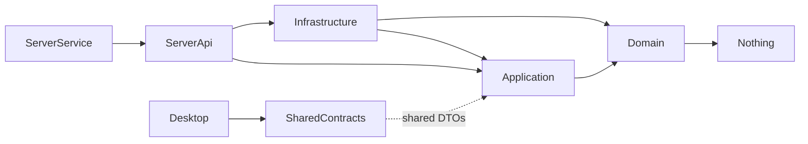

# Chima Customs B2 — System Specification: Implementation Plan

> Read `01-overview.md`, `02-architecture.md`, `03-functional-spec.md` first.
> This file is the contract between the spec and the AI coding agents (Claude Code, Cursor, GitHub Spec Kit).

---

## 1. Definition of Done (per feature)

A feature is **Done** only when **all** of the following are true:

1. Code merged behind required-review on `main`.
2. Domain invariants are unit-tested (xUnit + FluentAssertions).
3. Application use cases are unit-tested with mocked repositories.
4. API endpoints have integration tests using `WebApplicationFactory<Program>` against an in-memory SQLite.
5. All Gherkin acceptance criteria from `03-functional-spec.md` are covered by tests, named `Should_<criterion>` and tagged `[Trait("Feature","F-XX")]`.
6. Vietnamese strings are in `Resources/Strings/AppResources.vi.resx` — no hard-coded user-facing text in code.
7. Logging at correct levels (Information for command success, Warning for retried errors, Error for unhandled).
8. AuditLog entry verified for write commands.
9. Manual smoke on the low-spec VM (see § 8) passes.
10. CHANGELOG entry added.

---

## 2. Sprint Plan (Phase 1 MVP, 12 weeks, 6 × 2-week sprints)

| Sprint | Goal | Features delivered |
|--------|------|---------------------|
| **S0 — Bootstrap** | Repo, CI, baseline projects, ADR-0001..0005 | Solution scaffold, CI pipeline, installer skeleton |
| **S1 — Core domain + auth** | F-01, F-02, F-03, F-04 | Login, users, master data |
| **S2 — Entry & exit happy path** | F-05, F-06, F-07, F-08 | End-to-end: create declaration, add vehicle, search, exit |
| **S3 — KVGS + ledger + realtime** | F-09, F-10 | KVGS, list view with SignalR push |
| **S4 — Background jobs + reports** | F-11, F-12, F-14 | Daily header, summary, reports |
| **S5 — Export, backup, audit** | F-13, F-15, F-16, F-18 | Excel export, backup/restore, audit, health |
| **S6 — Hardening & polish** | F-17, accessibility audit, docs, runbook, installer, UAT | Smart suggestions, performance pass, release |

Each sprint ends with a working `.exe` installer that the stakeholder can deploy on a test VM.

---

## 3. Repository Layout & Standards

### 3.1 Branching

- `main` — always green, deployable.
- `feat/F-XX-short-name` — one feature per branch.
- `chore/...`, `fix/...`, `refactor/...`, `docs/...` for non-feature work.
- Squash-merge to `main`. PR description must reference the feature ID(s) implemented.

### 3.2 Commit message convention

Conventional Commits:
```
feat(F-05): create declaration with first vehicle
fix(F-08): handle idempotency-key collision
docs: add ADR-0006 for SignalR fallback
```

### 3.3 Code style

- `dotnet format` enforced in CI (uses `.editorconfig`).
- Nullable reference types **enabled** project-wide.
- `TreatWarningsAsErrors=true`.
- Async by default for all I/O; never `.Result` or `.Wait()`.
- `record` for DTOs and value objects; `class` for entities.
- One public type per file.

### 3.4 Dependency rules



- Domain has zero outward references — not even `Microsoft.Extensions.*`.
- No project may reference `Desktop`.
- `B2.Desktop` and `B2.Server.Api` only share data via `B2.Shared.Contracts`.

### 3.5 Solution scaffolding command

```bash
dotnet new sln -n B2
dotnet new classlib -n B2.Domain -o src/B2.Domain
dotnet new classlib -n B2.Application -o src/B2.Application
dotnet new classlib -n B2.Infrastructure -o src/B2.Infrastructure
dotnet new webapi -n B2.Server.Api -o src/B2.Server.Api --use-minimal-apis
dotnet new worker -n B2.Server.Service -o src/B2.Server.Service
dotnet new classlib -n B2.Shared.Contracts -o src/B2.Shared.Contracts
dotnet new maui -n B2.Desktop -o src/B2.Desktop
# add tests
dotnet new xunit -n B2.Domain.Tests -o tests/B2.Domain.Tests
dotnet new xunit -n B2.Application.Tests -o tests/B2.Application.Tests
dotnet new xunit -n B2.Server.Api.Tests -o tests/B2.Server.Api.Tests
# wire up references per the dependency diagram
```

---

## 4. .NET MAUI-Specific Guidance

> .NET MAUI is fixed by stakeholder decision. Phase 1 ships **Windows target only**; the MAUI choice keeps macOS/iOS/Android open for future.

### 4.1 Target frameworks

In `B2.Desktop.csproj`:
```xml
<TargetFrameworks>net8.0-windows10.0.19041.0</TargetFrameworks>
<UseMaui>true</UseMaui>
<SingleProject>true</SingleProject>
<WindowsPackageType>None</WindowsPackageType> <!-- ship as plain exe, not MSIX -->
```

> `WindowsPackageType=None` is **required** so the installer (Velopack / Inno Setup) can deploy as a normal Win32 app — easier on locked-down customs PCs than MSIX.

### 4.2 MVVM pattern

- Use **CommunityToolkit.Mvvm** with source generators (`[ObservableProperty]`, `[RelayCommand]`).
- One ViewModel per Page. Pages register ViewModels via DI in `MauiProgram.cs`.
- Navigation: **Shell** with route registration (`Routing.RegisterRoute("entry", typeof(EntryPage))`).

### 4.3 HTTP client

Use **Refit** for typed API calls. Register in `MauiProgram.cs`:
```csharp
builder.Services
    .AddRefitClient<IB2Api>()
    .ConfigureHttpClient(c => c.BaseAddress = AppConfig.ServerBaseUrl)
    .AddPolicyHandler(RetryPolicies.Default());  // Polly v8
```

### 4.4 SignalR client

```csharp
var conn = new HubConnectionBuilder()
    .WithUrl($"{AppConfig.ServerBaseUrl}hubs/events", o => o.AccessTokenProvider = () => Task.FromResult(authState.Token))
    .WithAutomaticReconnect()
    .Build();
```

If the connection drops, ledger pages fall back to polling every 3 s until reconnected.

### 4.5 Theming for accessibility (WCAG AA)

- Base font size 16; large-text mode toggle bumps to 20.
- Color palette: store as `Resources/Styles/Colors.xaml` with verified contrast ratios:
  - Primary text on background: `#1B1B1F` on `#FFFBFE` → 17.4:1
  - Error: `#B3261E` on white → 7.2:1
  - Focus ring: `#1A73E8` outline 2 px

### 4.6 What MAUI is **not** good at — and our mitigation

| MAUI gap | Mitigation |
|----------|-----------|
| DataGrid is weak on Windows | Use **Syncfusion DataGrid Community License** for the ledger view OR build a virtualized `CollectionView` with column headers. ADR required if Syncfusion is chosen (license terms). |
| Native rich keyboard shortcut handling | Use `Microsoft.Maui.Controls.Window.AddKeyboardAccelerator` (Windows-only API call via partial class in `Platforms/Windows/`). |
| Hot reload flakiness | Document workaround in `docs/dev-setup.md`; pin SDK version. |

---

## 5. Database & Migrations

### 5.1 Connection string

```
Data Source=C:\ProgramData\B2\db\b2.db;
Cache=Shared;
Foreign Keys=True;
Pooling=True;
```

PRAGMAs applied at startup by infrastructure:
```sql
PRAGMA journal_mode=WAL;
PRAGMA synchronous=NORMAL;
PRAGMA temp_store=MEMORY;
PRAGMA mmap_size=268435456; -- 256 MB
PRAGMA busy_timeout=5000;
```

### 5.2 Migrations

- Use EF Core migrations: `dotnet ef migrations add <Name> -p src/B2.Infrastructure -s src/B2.Server.Service`.
- Migrations apply automatically at service startup (idempotent).
- Each migration must be reversible OR documented as forward-only with a backup-before-upgrade banner in the installer.

### 5.3 Indexes (Sprint 1 baseline)

```sql
CREATE UNIQUE INDEX IX_Declaration_Number ON Declaration(DeclarationNumber);
CREATE INDEX IX_Declaration_BusinessDate ON Declaration(BusinessDate);
CREATE INDEX IX_Declaration_Status ON Declaration(Status);
CREATE INDEX IX_Vehicle_DeclarationId ON Vehicle(DeclarationId);
CREATE INDEX IX_Vehicle_PlateLast4 ON Vehicle(PlateLast4); -- generated column for suffix search
CREATE INDEX IX_Vehicle_ExitMarked ON Vehicle(ExitMarked);
CREATE INDEX IX_AuditLog_EntityIdAt ON AuditLog(EntityType, EntityId, At);
```

`PlateLast4` is a `GENERATED ALWAYS AS (substr(PlateNumber, -4))` column to make suffix search index-friendly.

---

## 6. Testing Strategy

| Layer | Framework | Coverage target | Notes |
|-------|-----------|-----------------|-------|
| Domain | xUnit + FluentAssertions | ≥ 90% line | Pure logic, fast |
| Application | xUnit + NSubstitute | ≥ 80% line | Mock repos, test invariants |
| Infrastructure | xUnit + real SQLite (in-memory) | smoke | Repository + EF integration |
| Server.Api | xUnit + WebApplicationFactory | every endpoint, every Gherkin AC | Use `Microsoft.Data.Sqlite` in-memory mode with shared cache |
| Desktop | MAUI handler tests + ViewModel unit tests | critical view models only | UI E2E via Appium is out of scope for Phase 1 |
| Performance | NBomber | F-07, F-13, F-10 | Run before each release on the spec VM |

CI runs all but performance tests. Performance tests run nightly on a dedicated runner.

---

## 7. CI/CD

### Pipelines (GitHub Actions example, adapt for any runner)

```yaml
# .github/workflows/ci.yml
name: CI
on: [push, pull_request]
jobs:
  build:
    runs-on: windows-2022
    steps:
      - uses: actions/checkout@v4
      - uses: actions/setup-dotnet@v4
        with: { dotnet-version: '8.0.x' }
      - run: dotnet workload install maui
      - run: dotnet restore
      - run: dotnet format --verify-no-changes
      - run: dotnet build -c Release --no-restore /p:TreatWarningsAsErrors=true
      - run: dotnet test -c Release --no-build --collect:"XPlat Code Coverage"
      - uses: actions/upload-artifact@v4
        with: { name: coverage, path: '**/coverage.cobertura.xml' }
```

A separate `release.yml` triggered on tags builds the installer artifact.

---

## 8. The "Spec VM" — required for every smoke test

Any AI agent or human producing a release candidate **must** validate it on a representative VM:

| Spec | Value |
|------|-------|
| vCPU | 2 |
| RAM | 4 GB |
| OS | Windows 10 64-bit, version 21H2 |
| .NET runtime | NOT pre-installed (the installer must bring it) |
| Office | 2010 (only relevant if testing Excel handoff) |

Smoke checklist (5 minutes) — **entry-gate machine**:
1. Unpack `B2Clearance-<version>-offline.zip`, run `.\install.ps1` as Administrator, accept
   defaults → service is created and starts.
2. Open Desktop on the same VM, log in as default Admin → change password forced.
3. Add 1 Processor + 1 Yard.
4. Create 1 declaration with 2 vehicles.
5. Search by 4-digit suffix → finds them.
6. Mark both exits → declaration goes green.
7. Confirm KVGS → green clears.
8. Export Excel → file opens in Excel 2010 (or LibreOffice as proxy) without errors.
9. "Backup now" → file appears in the backup folder.
10. Stop service → desktop shows clear "Mất kết nối" with retry.

**Exit-gate machine (second PC on the LAN) — required, not optional.** The gate runs two lanes
(`Business rules - Hướng dẫn điền sổ B2.md` § B): the entry-gate PC hosts the service and the
exit-gate PC is a LAN client. A single-machine smoke test exercises none of that path, and the
client endpoint / server binding it depends on were both broken until 2026-08-01. Run:

11. `.\install.ps1 -ClientOnly -ServerUrl <entry-gate-ip> -ServerCertificate <b2-server.cer>` →
    no service registered, no recovery code, `Desktop\b2-client.json` written with that address,
    the printed Thumbprint matches the entry gate's, and the Desktop connects over
    `https://<entry-gate-ip>:5001/` with no certificate error (#147 / #176).
12. Log in **as Operator** (not Admin) → 🟢 Online.
13. Find a vehicle entered on the other PC by its 3- and 4-digit suffix.
14. Mark both exits from here → the entry-gate screen updates within ≤ 1 s (SignalR).
15. Confirm KVGS **with that same Operator account** (FR-027) and edit a vehicle's Ghi chú.
16. Unplug the network → red banner + writes refused; plug back in → recovers without a restart.

The filled-in sign-off sheet is [`docs/uat-001-b2-clearance.md`](../docs/uat-001-b2-clearance.md).

---

## 9. ADR Process

Any deviation from a locked decision in `01-overview.md § 6` (tech stack) or this file requires an Architecture Decision Record under `docs/adr/NNNN-title.md` using this template:

```markdown
# ADR-NNNN: <title>
Status: Proposed | Accepted | Superseded by ADR-MMMM
Date: YYYY-MM-DD
## Context
## Decision
## Consequences
## Alternatives considered
```

Required ADRs to be authored before code:
- ADR-0001: Modular Monolith chosen over Microservices
- ADR-0002: SQLite chosen as primary store
- ADR-0003: .NET MAUI chosen as desktop UI framework
- ADR-0004: JWT (RS256) with local user store
- ADR-0005: Litestream for continuous backup

---

## 10. Security Checklist (must pass before each release)

- [ ] No secrets in code or repo (verified with `gitleaks`).
- [ ] All API endpoints require auth except `/api/auth/login` and `/api/admin/health`.
- [ ] All write commands check role policy.
- [ ] AuditLog row created for every successful write.
- [ ] BCrypt cost = 10; password min length 10, must include 3 of 4 char classes.
- [ ] Self-signed cert installed by installer to LocalMachine\Root.
- [ ] Firewall rule scoped to LAN profile only.
- [ ] DPAPI used to seal the JWT signing key on disk.
- [ ] Backup zip uses AES-256.
- [ ] Default admin credentials forced to be changed on first login.
- [ ] Failed login lockout active.
- [ ] Idle session timeout enforced.

---

## 11. Performance Budget

| Operation | p95 budget | Test |
|-----------|-----------|------|
| Login | < 400 ms | API integration |
| Create declaration | < 200 ms | API integration |
| Search by suffix (50k vehicles) | < 200 ms | NBomber |
| Mark exit | < 150 ms | NBomber |
| List declarations (page of 50) | < 250 ms | NBomber |
| Excel export 30 days (~3,500 declarations) | < 10 s | NBomber |
| Cold app startup on spec VM | < 5 s | Manual stopwatch |
| Service memory after 24 h | < 250 MB | Spec VM observation |

---

## 12. Operator Runbook (must ship with v1)

The runbook (`docs/runbook.md`) is a 5-page Vietnamese document the operator team can follow without help. It must contain:

1. How to start / stop the service.
2. How to reset the Admin password (offline procedure with a recovery code).
3. How to take a manual backup (in-app + file system fallback).
4. How to restore from a backup (with the warning about lost-since-backup data).
5. How to read the in-app health dashboard.
6. Common errors and their fixes (3 most likely, written in plain Vietnamese).
7. Phone/email of the development team for escalation.

Without this runbook, **the release does not ship**.

---

## 13. Deliverables Checklist for Phase 1 GA

- [ ] All P0 features (F-01 … F-13, F-15) — Done per § 1
- [ ] All P1 features (F-14, F-16, F-18) — Done per § 1
- [ ] F-17 implemented or explicitly deferred to Phase 2 with stakeholder sign-off
- [ ] Installer artifact (.exe) builds reproducibly from a tag
- [ ] Spec VM smoke test passes (§ 8)
- [ ] Performance budget met (§ 11)
- [ ] Security checklist passed (§ 10)
- [ ] Vietnamese runbook delivered (§ 12)
- [ ] Two on-site training sessions delivered & feedback incorporated
- [ ] Source code + ADRs handed over to the customer's chosen vendor for long-term maintenance

---

## 14. How an AI Coding Agent Should Approach This Spec

**Recommended workflow** (Claude Code / Cursor / Spec Kit):

1. **Plan**: Read all 4 spec files. Generate a task list mapping each feature ID (F-01 … F-18) to one or more PR-sized tasks.
2. **Bootstrap**: Execute § 3.5 commands. Wire up CI per § 7. Author the 5 required ADRs (§ 9).
3. **Per feature**:
   1. Open a branch `feat/F-XX-...`.
   2. Translate every Gherkin scenario from `03-functional-spec.md` into a failing test first.
   3. Implement Domain → Application → Infrastructure → API → Desktop, in that order.
   4. Add `AppResources.vi.resx` strings.
   5. Run smoke checklist on the spec VM.
   6. Open PR with feature ID in title; auto-link the relevant Gherkin tests.
4. **Do not** invent new endpoints, DTOs, or libraries. Any deviation needs an ADR (§ 9).
5. **Always** read business rules in `Business rules - Hướng dẫn điền sổ B2.md` before touching anything related to columns A–P.
6. **When stuck**, write the question into `docs/open-questions.md` and proceed with a clearly-marked assumption rather than blocking.

---

## 15. References

- `Định nghĩa yêu cầu.md` — original Vietnamese requirement
- `Business rules - Hướng dẫn điền sổ B2.md` — column-by-column rules
- `Mẫu sổ B2.xlsx` — Excel template (used for export)
- `Mẫu sổ B2.pdf` — visual reference of the legacy form
