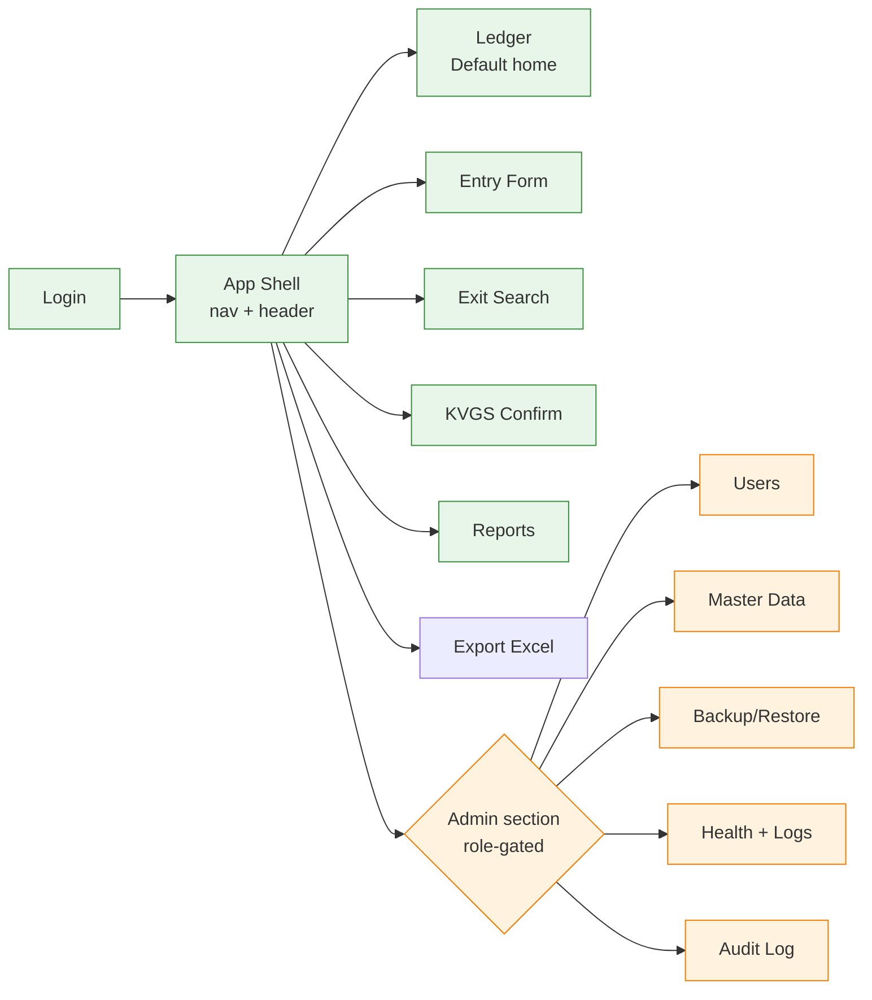

# Chima Customs B2 — System Specification: UI Wireframes & Design System

> Read `01-overview.md`, `02-architecture.md`, `03-functional-spec.md`, `04-implementation-plan.md` first.
> This file is **binding** for `/speckit.plan` and `/speckit.implement` — wireframes here become UI acceptance criteria. Layout, control placement, keyboard order, and design tokens must be respected by AI coding agents.

---

## 1. Design Principles

| # | Principle | How it's enforced |
|---|-----------|-------------------|
| D1 | **Anchor familiarity** — UI ledger view mimics the Sổ B2 Excel layout (column order, row colors) so users transition smoothly | Ledger column order = A,B,C,D,E,F,G,H,I,J,K,L,M,N,O of Sổ B2 |
| D2 | **Keyboard-first** — every flow completable without mouse | Tab order specified per page; shortcuts documented |
| D3 | **Minimal click depth** — common tasks (entry, exit) reachable from app shell in 1 click | Sidebar pinned to entry/exit/search |
| D4 | **Big, scannable, accessible** — base font 16sp; large-text mode 20sp | Tokens in § 3 |
| D5 | **Status by color + icon + text** (never color alone — WCAG 1.4.1) | Status badges always show icon + label |
| D6 | **Errors loud, success quiet** — errors block flow; success shows toast + auto-dismiss | Toast component spec in § 4 |
| D7 | **Progressive disclosure** — admin/advanced features behind explicit role-gated nav items | Sidebar items shown by role |

---

## 2. Color Palette (WCAG 2.1 AA verified)

> Picked: **Government Navy** primary (signals authority/customs), **Slate Grey** neutral, **Status colors** consistent with Sổ B2 conventions (red = inside/pending, green = ready, blue = confirmed).
>
> All text-on-background combinations below are tested for contrast ratio ≥ 4.5:1 (normal text) or ≥ 3:1 (large text/UI components).

| Token | Hex | Use | Contrast on white |
|-------|-----|-----|-------------------|
| `Color.Primary` | `#1A3A6E` | App bar, primary buttons, links | 9.8:1 ✅ |
| `Color.PrimaryHover` | `#0F2347` | Hover state | 14.6:1 ✅ |
| `Color.PrimaryOnDark` | `#FFFFFF` | Text on Primary background | 9.8:1 ✅ |
| `Color.Surface` | `#FFFBFE` | Page background | — |
| `Color.SurfaceVariant` | `#F4F4F7` | Card/panel background | — |
| `Color.OnSurface` | `#1B1B1F` | Body text | 17.4:1 ✅ |
| `Color.OnSurfaceMuted` | `#5A5A66` | Secondary text, labels | 7.1:1 ✅ |
| `Color.Border` | `#D6D6DD` | Dividers, input borders | 1.8:1 (UI ≥ 3:1 ❌ — only for non-essential dividers; use `OnSurfaceMuted` for focus borders) |
| `Color.BorderFocus` | `#1A73E8` | Focus rings (2px outline) | 4.6:1 ✅ |
| `Color.StatusInside` | `#B3261E` | Vehicle inside (chưa ra) — red text | 7.2:1 ✅ |
| `Color.StatusInsideBg` | `#FDECEC` | Subtle red background | — |
| `Color.StatusReady` | `#1B5E20` | Declaration ready for KVGS — green text | 8.9:1 ✅ |
| `Color.StatusReadyBg` | `#E6F4EA` | Subtle green background (parent row fill) | — |
| `Color.StatusConfirmed` | `#0D47A1` | KVGS confirmed — blue text | 11.2:1 ✅ |
| `Color.StatusConfirmedBg` | `#E3F2FD` | Subtle blue background | — |
| `Color.Warning` | `#8C5000` | Warning text | 6.4:1 ✅ |
| `Color.WarningBg` | `#FFF4E5` | Warning background | — |
| `Color.Error` | `#B3261E` | Error text | 7.2:1 ✅ |
| `Color.ErrorBg` | `#FDECEC` | Error background | — |
| `Color.Success` | `#1B5E20` | Success text | 8.9:1 ✅ |
| `Color.Disabled` | `#9C9CA8` | Disabled text | 3.4:1 (only on white) |

> **AI agents**: store these as `StaticResource` in `Resources/Styles/Colors.xaml`. Never hard-code hex elsewhere.

---

## 3. Typography & Spacing Tokens

| Token | Value | Use |
|-------|-------|-----|
| `Font.Family` | "Segoe UI", "Inter", system default | All text |
| `Font.SizeXS` | 12 | Captions, helper text |
| `Font.SizeS` | 14 | Secondary labels |
| `Font.SizeM` | **16** (default body) | Body text, inputs |
| `Font.SizeL` | 18 | Subheadings |
| `Font.SizeXL` | 22 | Page titles |
| `Font.SizeXXL` | 28 | Dashboard numbers |
| `Font.SizeLargeMode` | +4 across the board | When user toggles "Cỡ chữ lớn" |
| `Font.WeightRegular` | 400 | Default |
| `Font.WeightMedium` | 500 | Labels, emphasis |
| `Font.WeightBold` | 700 | Headings, status badges |
| `Spacing.XS` | 4 | Tight gaps |
| `Spacing.S` | 8 | Inside controls |
| `Spacing.M` | 16 | Default padding |
| `Spacing.L` | 24 | Section gaps |
| `Spacing.XL` | 32 | Page padding |
| `Radius.S` | 4 | Inputs |
| `Radius.M` | 8 | Cards, buttons |
| `Touch.MinTarget` | 44 × 44 px | Min interactive target (WCAG 2.5.5) |

---

## 4. Information Architecture



### Sidebar visibility per role

| Sidebar item | Admin | Operator | Supervisor |
|--------------|:-----:|:--------:|:----------:|
| Sổ B2 (Ledger) | ✅ | ✅ | ✅ |
| Nhập xe vào | ✅ | ✅ | — |
| Xác nhận xe ra | ✅ | ✅ | — |
| Xác nhận KVGS | ✅ | — | ✅ |
| Báo cáo | ✅ | — | ✅ |
| Xuất Excel | ✅ | — | ✅ |
| **Quản trị** (group) | ✅ | — | — |

---

## 5. App Shell Layout (applies to all pages except Login)

```
┌──────────────────────────────────────────────────────────────────────────┐
│  🛂 SỔ B2 — Cửa khẩu Chi Ma          [🟢 Online]  Nguyễn Văn Nam ▾ ⚙️   │  ← Top bar (height 56)
├────────────┬─────────────────────────────────────────────────────────────┤
│            │                                                             │
│  📋 Sổ B2  │                                                             │
│  ➕ Nhập   │                                                             │
│  🔍 Xe ra  │              ◀  PAGE CONTENT AREA ▶                          │
│  ✅ KVGS   │                (each page wireframe in §6)                 │
│  📊 BC     │                                                             │
│  📤 Excel  │                                                             │
│  ─────     │                                                             │
│  ⚙️  QTri  │                                                             │
│            │                                                             │
│            │                                                             │
├────────────┴─────────────────────────────────────────────────────────────┤
│  Cỡ chữ: [Bình thường ▼]   Phím tắt: F1   Mã phiên: a1b2c3   v1.0.0     │  ← Status bar (height 32)
└──────────────────────────────────────────────────────────────────────────┘
```

### Top bar behaviors

| Element | Behavior |
|---------|----------|
| App title | Click → goes to Ledger |
| `[🟢 Online]` badge | Green when SignalR connected; Yellow `[🟡 Đang thử lại]` when polling fallback; Red `[🔴 Mất kết nối]` when no server reachable. Click → opens Health page (Admin) or readonly health popup (others) |
| User menu | Dropdown: Đổi mật khẩu / Đăng xuất |
| ⚙️ icon | Quick settings: cỡ chữ, độ tương phản cao |

### Sidebar behaviors

- Width: 220 px expanded, 56 px collapsed (icon-only).
- Collapse toggle at bottom.
- Active item highlighted with `Color.Primary` left bar (4 px) + bold text.
- Keyboard: `Alt+1`..`Alt+8` jumps to nav items.

### Status bar behaviors

- Font size selector applies app-wide (Bình thường = 16, Lớn = 20, Rất lớn = 24).
- F1 opens shortcut cheat sheet modal.
- Mã phiên = correlation ID of current session, useful for support.

---

## 6. Page Wireframes

### 6.1 — Login

**Maps to**: F-01

```
┌──────────────────────────────────────────────────────────────────────────┐
│                                                                          │
│                                                                          │
│                          🛂 SỔ B2 — CHI MA                                │
│                       Phần mềm quản lý thông quan                        │
│                                                                          │
│                  ┌────────────────────────────────────┐                  │
│                  │                                    │                  │
│                  │  Tên đăng nhập                     │                  │
│                  │  ┌──────────────────────────────┐  │                  │
│                  │  │ nam                          │  │  ← TAB 1         │
│                  │  └──────────────────────────────┘  │                  │
│                  │                                    │                  │
│                  │  Mật khẩu                          │                  │
│                  │  ┌──────────────────────────────┐  │                  │
│                  │  │ ••••••••              [👁]   │  │  ← TAB 2         │
│                  │  └──────────────────────────────┘  │                  │
│                  │                                    │                  │
│                  │  ⚠️  Sai tên đăng nhập hoặc mật    │  ← Error region  │
│                  │     khẩu (3/5 lần)                 │     (a11y live)  │
│                  │                                    │                  │
│                  │  ┌──────────────────────────────┐  │                  │
│                  │  │       ĐĂNG NHẬP              │  │  ← TAB 3 (Enter) │
│                  │  └──────────────────────────────┘  │                  │
│                  │                                    │                  │
│                  └────────────────────────────────────┘                  │
│                                                                          │
│                                v1.0.0                                    │
└──────────────────────────────────────────────────────────────────────────┘
```

**Elements & Behaviors**

| Element | Behavior | Validation |
|---------|----------|------------|
| Tên đăng nhập | Autofocus on page load | Required, trim whitespace |
| Mật khẩu | Show/hide toggle (👁); supports paste | Required, min 1 char (server enforces complexity) |
| Đăng nhập | Default action = Enter | Disabled while loading; spinner inline |
| Error region | `aria-live="polite"`; shows attempt count after 3 failed attempts | — |
| Lockout state | After 5 fails: shows "Tài khoản tạm khóa 15 phút" + countdown; disables form | Server-enforced |

**Tab order**: Username → Password → Show/Hide → Login button.
**Keyboard**: Enter submits from any field.

---

### 6.2 — Ledger (Default Home)

**Maps to**: F-10, F-07 (search bar at top), shows F-08/F-09 results

```
┌──────────────────────────────────────────────────────────────────────────┐
│ TOP BAR                                                                  │
├────────┬─────────────────────────────────────────────────────────────────┤
│ NAV    │ Sổ B2 — 03/05/2026                                              │
│        │ ┌─────────────────────────────────────────────────────────────┐ │
│        │ │ 🔍 Tìm xe (3-4 số cuối):  [____]  [Tìm]   ✓ Chỉ xe chưa ra │ │  ← Sticky search row
│        │ └─────────────────────────────────────────────────────────────┘ │
│        │                                                                 │
│        │ Lọc: [Hôm nay ▼] [Trạng thái: Tất cả ▼] [Bãi: Tất cả ▼] [Reset]│
│        │                                                                 │
│        │ ┌────┬───────┬──────────┬──────┬──────┬────────┬─────┬───────┐ │
│        │ │ #  │ Người │ Số tờ    │ Cty  │ Biển │ Mooc/  │ Bãi │ Giờ   │ │  ← Header
│        │ │    │ làm   │ khai     │      │ số   │ Cont   │     │ vào   │ │     (sticky)
│        │ ├────┼───────┼──────────┼──────┼──────┼────────┼─────┼───────┤ │
│        │ │ 📋 │       │          │      │      │        │     │       │ │  ← DAILY HEADER
│        │ │ 03/05/2026 — Trực chính: Nguyễn Văn Nam — Tổng: -- (chốt 23h)│     row (full-width)
│        │ ├────┼───────┼──────────┼──────┼──────┼────────┼─────┼───────┤ │
│        │ │ 🟢1│ N.V.Nam│ 1234...12│ Cty A│12H05769│12RM057│ QP │ 13:16 │ │  ← Parent (green=AllExited)
│        │ │ ⬇  │       │          │      │ 29A12345│         │     │ 13:18 │ │  ← Child vehicles
│        │ │ ⬇  │       │          │      │ 29A99888│         │     │ 13:20 │ │
│        │ ├────┼───────┼──────────┼──────┼──────┼────────┼─────┼───────┤ │
│        │ │ 🔴2│ N.A.Dũng│ 5678...90│ Cty B│30G12345│         │ HQ │ 13:30 │ │  ← Open (red text=inside)
│        │ ├────┼───────┼──────────┼──────┼──────┼────────┼─────┼───────┤ │
│        │ │ 🔵3│ N.V.Nam│ 9999...11│ Cty C│12H77777│ 12RM77 │ QP │ 14:00 │ │  ← KVGSConfirmed (blue)
│        │ └────┴───────┴──────────┴──────┴──────┴────────┴─────┴───────┘ │
│        │                                                                 │
│        │ Hiển thị 1-50 của 248       [◀ Trước]  Trang 1/5  [Sau ▶]      │
├────────┴─────────────────────────────────────────────────────────────────┤
│ STATUS BAR                                                               │
└──────────────────────────────────────────────────────────────────────────┘
```

**Status icons (always icon + color, never color alone — D5)**:
- 🔴 = Open (xe đang ở trong)
- 🟢 = AllExited (đã ra hết, chờ KVGS)
- 🔵 = KVGSConfirmed (đã xác nhận, đóng)
- 📋 = Daily header row

**Row interactions**:
- Click parent row → expand/collapse children.
- Right-click parent → context menu: Mở chi tiết / Xác nhận KVGS / Sao chép số tờ khai.
- Right-click child → Đánh dấu xe ra / Sao chép biển số / Mở chi tiết.
- Double-click any row → opens detail drawer (right side, 40% width).

**Real-time updates** (SignalR push):
- Color/state changes animate over 300 ms (avoid jarring jumps).
- New row inserted at top with brief highlight pulse (400 ms).

**Tab order**: Search input → Search button → Unexited filter → Date filter → Status filter → Yard filter → Reset → Table (arrow keys navigate rows).

**Keyboard**:
- `/` focuses search.
- `Enter` in search → execute search.
- `Esc` clears search.
- `Arrow Up/Down` in table → move selection.
- `Enter` on row → open detail drawer.
- `F5` → refresh (manual; usually not needed due to SignalR).

---

### 6.3 — Entry Form (Nhập xe vào)

**Maps to**: F-05, F-06

```
┌──────────────────────────────────────────────────────────────────────────┐
│ TOP BAR                                                                  │
├────────┬─────────────────────────────────────────────────────────────────┤
│ NAV    │ Nhập xe vào                                                     │
│        │ ┌─ Tờ khai ─────────────────────────────────────────────────┐  │
│        │ │ Số tờ khai *      ┌─────────────────────┐ (12 chữ số)     │  │
│        │ │                   │ 123456789012        │ ✓ Hợp lệ        │  │  ← TAB 1
│        │ │                   └─────────────────────┘                  │  │
│        │ │                                                             │  │
│        │ │ Người làm thủ tục *  ┌──────────────▼──┐                  │  │  ← TAB 2 (combo,
│        │ │                      │ Nguyễn Văn Nam  │                  │  │     filterable)
│        │ │                      └─────────────────┘                   │  │
│        │ │                                                             │  │
│        │ │ Tên công ty *        ┌──────────────────────────────────┐  │  │  ← TAB 3
│        │ │                      │ Công ty TNHH ABC                  │  │  │     (auto-suggest
│        │ │                      └──────────────────────────────────┘  │  │      from history)
│        │ │                                                             │  │
│        │ │ Tên hàng *           ┌──────────────────────────────────┐  │  │  ← TAB 4
│        │ │                      │ Quần áo dệt may                   │  │  │
│        │ │                      └──────────────────────────────────┘  │  │
│        │ │                                                             │  │
│        │ │ Tên bãi *            ┌──────────────▼──┐                  │  │  ← TAB 5 (combo)
│        │ │                      │ QP — Bãi Quân...│                  │  │
│        │ │                      └─────────────────┘                   │  │
│        │ └─────────────────────────────────────────────────────────────┘  │
│        │                                                                 │
│        │ ┌─ Xe đầu tiên ────────────────────────────────────────────┐  │
│        │ │ Biển số xe *      ┌─────────────────┐ (auto in hoa)       │  │  ← TAB 6
│        │ │                   │ 12H05769        │                      │  │
│        │ │                   └─────────────────┘                      │  │
│        │ │                                                             │  │
│        │ │ Số mooc/Cont      ┌─────────────────┐ Gợi ý: 12RM05769 ⇥  │  │  ← TAB 7
│        │ │                   │ 12RM05769       │  (Tab để chấp nhận) │  │     (smart suggest)
│        │ │                   └─────────────────┘                      │  │
│        │ │                                                             │  │
│        │ │ Ghi chú           ┌──────────────────────────────────────┐ │  │  ← TAB 8
│        │ │                   │                                      │ │  │
│        │ │                   └──────────────────────────────────────┘ │  │
│        │ └─────────────────────────────────────────────────────────────┘  │
│        │                                                                 │
│        │            [Hủy (Esc)]  [Lưu và nhập xe khác (Ctrl+Enter)]     │  ← Buttons
│        │                                          [Lưu (Enter)]          │  ← TAB 9, 10, 11
│        │                                                                 │
│        │ 💡 Gợi ý gần đây: BS 12H05769 thường đi với mooc 12RM05769     │  ← Footer hint
├────────┴─────────────────────────────────────────────────────────────────┤
└──────────────────────────────────────────────────────────────────────────┘
```

**Validation feedback**:
- Inline ✓ Hợp lệ / ✗ Sai (12 chữ số bắt buộc) appears next to field after blur.
- Submit-blocking errors summarized at top in `aria-live` region.
- Server errors (duplicate declaration, master not found) shown inline + at top.

**Smart suggestions** (F-17 — must work from Phase 1 even if simple):
- Plate → Mooc/Container: when plate matches a frequent pair from last 90 days, ghost text shows; `Tab` accepts.
- Company name autocomplete: dropdown of last 20 distinct companies for this processor.

**Tab order**: 11 stops as labeled. After last button, focus loops back to first field on `Tab`, or to Cancel button on `Shift+Tab`.

**Keyboard shortcuts**:
- `Esc` → Cancel (with confirm if dirty).
- `Enter` (in any field) → Lưu.
- `Ctrl+Enter` → Lưu và mở form mới (giữ thông tin tờ khai cho xe tiếp theo).

**"Add more vehicles" mode** (F-06):
- After save, if user pressed Ctrl+Enter, the Tờ khai section becomes read-only (greyed) and the Xe section resets. A banner appears: "Đang thêm xe vào tờ khai 1234...12 — [Đổi tờ khai]".

---

### 6.4 — Exit Search & Confirm (Xác nhận xe ra)

**Maps to**: F-07, F-08

```
┌──────────────────────────────────────────────────────────────────────────┐
│ TOP BAR                                                                  │
├────────┬─────────────────────────────────────────────────────────────────┤
│ NAV    │ Xác nhận xe ra                                                  │
│        │                                                                 │
│        │ ┌─────────────────────────────────────────────────────────────┐ │
│        │ │ Nhập 3-4 số cuối biển số                                    │ │
│        │ │ ┌──────────────────────┐                                    │ │
│        │ │ │ 5769            [⏎] │  ← BIG INPUT (height 56, font 24)  │ │
│        │ │ └──────────────────────┘                                    │ │
│        │ └─────────────────────────────────────────────────────────────┘ │
│        │                                                                 │
│        │ Kết quả (2 xe khớp, đang ở trong):                              │
│        │                                                                 │
│        │ ┌────────────────────────────────────────────────────────────┐ │
│        │ │ ▶ 12H05769  Cty TNHH ABC  Bãi QP  Vào: 13:16 (3h trước)   │ │  ← Highlighted row
│        │ │   Tờ khai: 1234...12  Mooc: 12RM05769                      │ │
│        │ │   [✓ ĐÁNH DẤU XE ĐÃ RA (Enter)]                            │ │  ← Big action button
│        │ ├────────────────────────────────────────────────────────────┤ │
│        │ │   29A05769  Cty XYZ      Bãi HQ  Vào: 14:30 (1h trước)    │ │
│        │ │   Tờ khai: 5678...90  Mooc: -                              │ │
│        │ │   [✓ Đánh dấu xe đã ra]                                    │ │
│        │ └────────────────────────────────────────────────────────────┘ │
│        │                                                                 │
│        │ 💡 Mẹo: Bấm Enter để chọn xe đầu, Tab để chọn xe khác         │
│        │                                                                 │
│        │ ─── Phiên làm việc của bạn ───                                 │
│        │ Đã đánh dấu hôm nay: 47 xe   Lần cuối: 14:25                   │  ← Self-monitoring
│        │ [Xem lịch sử thao tác →]                                       │
├────────┴─────────────────────────────────────────────────────────────────┤
└──────────────────────────────────────────────────────────────────────────┘
```

**Behaviors**:
- Search input is autofocused on page load and after every successful exit confirmation.
- Search executes on `Enter` OR after 500 ms debounce typing.
- If exactly 1 result matches and user presses Enter twice (Enter to search → Enter to confirm), the exit is marked.
- If 0 results: "Không tìm thấy xe khớp với '5769' đang ở trong cổng. Kiểm tra lại số biển hoặc xem [Sổ B2]."
- If >5 results: warn "Quá nhiều kết quả. Hãy nhập đủ 4 chữ số."

**After successful exit**:
- Toast (top-right): "✅ Đã đánh dấu 12H05769 ra cổng lúc 16:42"
- Search input clears and refocuses.
- If declaration becomes AllExited as result: additional info toast: "Tờ khai 1234...12 đủ điều kiện KVGS"

**Tab order**: Search → for each result row: row focus → action button.

**Keyboard**:
- `Enter` in search → search.
- `Enter` on focused result → mark exit.
- `Esc` → clear search.
- `↓/↑` → move between results.

---

### 6.5 — KVGS Confirm Page

**Maps to**: F-09 (also accessible via context-menu from Ledger)

```
┌──────────────────────────────────────────────────────────────────────────┐
│ TOP BAR                                                                  │
├────────┬─────────────────────────────────────────────────────────────────┤
│ NAV    │ Xác nhận KVGS                                                   │
│        │                                                                 │
│        │ Tờ khai chờ xác nhận (3):                                       │
│        │                                                                 │
│        │ ┌────────────────────────────────────────────────────────────┐ │
│        │ │ 🟢 1234567890 12        Cty TNHH ABC        Bãi QP         │ │
│        │ │     3 xe — đã ra đủ lúc 16:42                              │ │
│        │ │     Người nhập: Nguyễn Văn Nam                              │ │
│        │ │     [Xem chi tiết]    [✓ XÁC NHẬN KVGS (Enter)]           │ │  ← Primary action
│        │ ├────────────────────────────────────────────────────────────┤ │
│        │ │ 🟢 5678901234 56        Cty XYZ             Bãi HQ         │ │
│        │ │     1 xe — đã ra lúc 16:55                                 │ │
│        │ │     [Xem chi tiết]    [✓ Xác nhận KVGS]                    │ │
│        │ ├────────────────────────────────────────────────────────────┤ │
│        │ │ 🟢 9999888877 11        Cty DEF             Bãi QP         │ │
│        │ │     2 xe — đã ra đủ lúc 17:10                              │ │
│        │ │     [Xem chi tiết]    [✓ Xác nhận KVGS]                    │ │
│        │ └────────────────────────────────────────────────────────────┘ │
│        │                                                                 │
│        │ Đã xác nhận hôm nay: 24 tờ khai                                │
│        │ [Xem lịch sử →]                                                 │
├────────┴─────────────────────────────────────────────────────────────────┤
└──────────────────────────────────────────────────────────────────────────┘
```

**Confirm interaction**:
- Click "Xác nhận KVGS" → confirmation dialog (modal, focus-trapped):
  ```
  ┌─────────────────────────────────────────┐
  │ Xác nhận KVGS                           │
  ├─────────────────────────────────────────┤
  │ Bạn xác nhận tờ khai 1234567890 12 đã   │
  │ hoàn tất kiểm tra giám sát?             │
  │                                         │
  │ Hành động này không thể hoàn tác.       │
  │                                         │
  │            [Hủy]    [Xác nhận]          │
  └─────────────────────────────────────────┘
  ```
- After confirm: row removes from list (animated 300 ms), toast "✅ Đã xác nhận KVGS cho tờ khai ..."

**Empty state**:
```
                  📋
        Chưa có tờ khai nào chờ KVGS
       Xem [Sổ B2] để theo dõi trạng thái
```

---

### 6.6 — Reports (Báo cáo)

**Maps to**: F-14

```
┌──────────────────────────────────────────────────────────────────────────┐
│ TOP BAR                                                                  │
├────────┬─────────────────────────────────────────────────────────────────┤
│ NAV    │ Báo cáo                                                         │
│        │ ┌──────────────────────────────────────────────────────────┐   │
│        │ │ Loại báo cáo: [Theo người làm thủ tục ▼]                 │   │
│        │ │                                                            │   │
│        │ │ Từ ngày: [01/05/2026]    Đến ngày: [03/05/2026]          │   │
│        │ │                                                            │   │
│        │ │                                       [Tạo báo cáo]       │   │
│        │ └──────────────────────────────────────────────────────────┘   │
│        │                                                                 │
│        │ Kết quả: Người làm thủ tục — 01/05–03/05/2026                  │
│        │ ┌─────────────────────────┬──────────────┬─────────────────┐  │
│        │ │ Người làm thủ tục       │ Số xe đã ra  │ % tổng           │  │
│        │ ├─────────────────────────┼──────────────┼─────────────────┤  │
│        │ │ Nguyễn Anh Dũng         │          145 │  ████████ 32%   │  │
│        │ │ Nguyễn Văn Nam          │          120 │  ███████  27%   │  │
│        │ │ Trần Thị Linh           │           98 │  █████    22%   │  │
│        │ │ Phạm Văn Hùng           │           85 │  ████     19%   │  │
│        │ ├─────────────────────────┼──────────────┼─────────────────┤  │
│        │ │ TỔNG                    │          448 │            100% │  │
│        │ └─────────────────────────┴──────────────┴─────────────────┘  │
│        │                                                                 │
│        │              [📋 Sao chép]  [📤 Xuất Excel]                    │
├────────┴─────────────────────────────────────────────────────────────────┤
└──────────────────────────────────────────────────────────────────────────┘
```

**Report types** (drop-down):
- Theo người làm thủ tục
- Theo bãi
- Theo khung giờ xe ra (kèm input "Khung phút": 30/60/120)
- Theo người nhập sổ / xác nhận
- Xe tồn (đang ở trong) — không cần date range, dùng "Tính đến: [datetime]"

**Behaviors**:
- Sortable columns.
- Bar visualization inline (text-only `█` characters keep it accessible & low-tech).
- Export Excel from any report (uses ClosedXML, not the Sổ B2 template — simpler tabular format).

---

### 6.7 — Export Excel (Xuất Sổ B2)

**Maps to**: F-13

```
┌──────────────────────────────────────────────────────────────────────────┐
│ TOP BAR                                                                  │
├────────┬─────────────────────────────────────────────────────────────────┤
│ NAV    │ Xuất Sổ B2                                                      │
│        │                                                                 │
│        │ ┌────────────────────────────────────────────────────────────┐ │
│        │ │ Khoảng thời gian:                                          │ │
│        │ │   ⦿ Hôm nay (03/05/2026)                                   │ │
│        │ │   ○ Hôm qua                                                │ │
│        │ │   ○ Tuần này (28/04 - 03/05)                               │ │
│        │ │   ○ Tháng này (01/05 - 03/05)                              │ │
│        │ │   ○ Tùy chọn:  [01/05/2026] đến [03/05/2026]              │ │
│        │ │                                                            │ │
│        │ │ Bao gồm:                                                   │ │
│        │ │   ☑ Dòng tiêu đề ngày (chốt 23h)                          │ │
│        │ │   ☑ Tô màu trạng thái (đỏ/xanh)                           │ │
│        │ │   ☑ Cột ghi chú                                           │ │
│        │ │                                                            │ │
│        │ │ Ước tính: ~248 dòng · ~80 KB                              │ │
│        │ │                                                            │ │
│        │ │                                  [Hủy]  [📤 Xuất file]    │ │
│        │ └────────────────────────────────────────────────────────────┘ │
│        │                                                                 │
│        │ Lần xuất gần nhất: 02/05/2026 23:05 — Sổ_B2_20260502.xlsx      │
│        │ [Mở thư mục Tải xuống]                                          │
├────────┴─────────────────────────────────────────────────────────────────┤
└──────────────────────────────────────────────────────────────────────────┘
```

**While exporting**:
- Modal with progress: "Đang tạo file... 45%". Cancellable.
- On success: native Save As dialog with default name `So_B2_{from}_{to}.xlsx`.
- After save: toast "✅ Đã xuất file: Sổ_B2_20260503.xlsx · [Mở] · [Mở thư mục]"

---

### 6.8 — Admin: Users

**Maps to**: F-02

```
┌──────────────────────────────────────────────────────────────────────────┐
│ TOP BAR                                                                  │
├────────┬─────────────────────────────────────────────────────────────────┤
│ NAV    │ Quản trị > Người dùng                          [+ Thêm người dùng] │
│        │                                                                 │
│        │ Lọc: [Tất cả ▼]  [🔍 Tìm theo tên]                             │
│        │                                                                 │
│        │ ┌──────────┬──────────────┬─────────────┬───────┬─────────┐   │
│        │ │ Username │ Họ tên       │ Vai trò     │ Trạng │ Thao tác│   │
│        │ ├──────────┼──────────────┼─────────────┼───────┼─────────┤   │
│        │ │ admin    │ Quản trị     │ Admin       │ ✅    │ ✏️  🔑   │   │
│        │ │ nam      │ N. Văn Nam   │ Operator    │ ✅    │ ✏️  🔑 🚫│   │
│        │ │ dung     │ N. A. Dũng   │ Operator    │ ✅    │ ✏️  🔑 🚫│   │
│        │ │ linh     │ T. Thị Linh  │ Supervisor  │ ❌    │ ✏️  🔑 ✅│   │
│        │ │ hung     │ P. V. Hùng   │ Operator    │ ✅    │ ✏️  🔑 🚫│   │
│        │ └──────────┴──────────────┴─────────────┴───────┴─────────┘   │
│        │                                                                 │
│        │ 5 người dùng (4 đang hoạt động)                                │
├────────┴─────────────────────────────────────────────────────────────────┤
└──────────────────────────────────────────────────────────────────────────┘
```

**Action icons**: ✏️ Sửa · 🔑 Reset mật khẩu · 🚫 Vô hiệu hóa · ✅ Kích hoạt lại.
**Note**: No delete action (per F-02 — only deactivate).

**Add/Edit user dialog** (modal):
```
┌─────────────────────────────────────────────────────┐
│ Thêm người dùng                                  [×]│
├─────────────────────────────────────────────────────┤
│  Username *           [_________________]           │
│  Họ và tên *          [_________________]           │
│  Vai trò *            [Operator ▼]                  │
│  Mật khẩu tạm thời *  [_________________] [Sinh]    │
│                       (≥10 ký tự, 3/4 nhóm)         │
│                       ⚠️ Người dùng phải đổi MK khi  │
│                          đăng nhập lần đầu          │
│                                                     │
│                          [Hủy]    [Tạo người dùng] │
└─────────────────────────────────────────────────────┘
```

---

### 6.9 — Admin: Master Data (Tabbed)

**Maps to**: F-03, F-04

```
┌──────────────────────────────────────────────────────────────────────────┐
│ TOP BAR                                                                  │
├────────┬─────────────────────────────────────────────────────────────────┤
│ NAV    │ Quản trị > Dữ liệu chuẩn                                        │
│        │                                                                 │
│        │ [Người làm thủ tục] [Bãi]                                       │
│        │ ━━━━━━━━━━━━━━━━━━                                              │
│        │                                                                 │
│        │ Người làm thủ tục                          [+ Thêm]             │
│        │ ┌──────────────────────────────┬───────┬─────────┐             │
│        │ │ Họ tên                       │ Trạng │ Thao tác│             │
│        │ ├──────────────────────────────┼───────┼─────────┤             │
│        │ │ Nguyễn Văn Nam               │ ✅    │ ✏️ 🚫    │             │
│        │ │ Nguyễn Anh Dũng              │ ✅    │ ✏️ 🚫    │             │
│        │ │ Trần Thị Linh                │ ✅    │ ✏️ 🚫    │             │
│        │ │ Lê Văn Cũ                    │ ❌    │ ✏️ ✅    │  ← inactive │
│        │ └──────────────────────────────┴───────┴─────────┘             │
│        │                                                                 │
│        │ ⚠️  Vô hiệu hóa không xóa lịch sử. Tên cũ vẫn hiển thị trong   │
│        │     các tờ khai đã nhập.                                       │
├────────┴─────────────────────────────────────────────────────────────────┤
└──────────────────────────────────────────────────────────────────────────┘
```

**Yards tab** identical structure with columns: Mã · Tên đầy đủ · Trạng thái · Thao tác.

---

### 6.10 — Admin: Backup & Restore

**Maps to**: F-15

```
┌──────────────────────────────────────────────────────────────────────────┐
│ TOP BAR                                                                  │
├────────┬─────────────────────────────────────────────────────────────────┤
│ NAV    │ Quản trị > Sao lưu & khôi phục                                  │
│        │                                                                 │
│        │ ┌─ Sao lưu liên tục (tự động) ─────────────────────────────┐  │
│        │ │ Trạng thái: 🟢 Đang chạy                                 │  │
│        │ │ Lần đồng bộ cuối: 03/05/2026 14:32:05 (1 phút trước)    │  │
│        │ │                                                            │  │
│        │ │ Đích sao lưu:                                              │  │
│        │ │   • USB D:\B2-Backup\replica\         🟢 OK · 12 phút trước│  │
│        │ │   • LAN \\entry-pc\B2-Backup\         🟢 OK · 1 phút trước │  │
│        │ │                                                            │  │
│        │ │ [Cấu hình đích sao lưu]                                    │  │
│        │ └────────────────────────────────────────────────────────────┘  │
│        │                                                                 │
│        │ ┌─ Sao lưu tức thời ─────────────────────────────────────────┐ │
│        │ │ Tạo bản sao lưu đầy đủ (file .bak.zip mã hóa AES-256)     │ │
│        │ │                                  [💾 Sao lưu ngay]         │ │
│        │ │                                                            │ │
│        │ │ Lần sao lưu thủ công gần nhất:                            │ │
│        │ │   03/05/2026 08:00 — b2-20260503-0800.bak.zip · 4.2 MB   │ │
│        │ │   [Mở thư mục]                                            │ │
│        │ └────────────────────────────────────────────────────────────┘ │
│        │                                                                 │
│        │ ┌─ Khôi phục dữ liệu ⚠️  ────────────────────────────────────┐ │
│        │ │ Khôi phục sẽ thay thế toàn bộ dữ liệu hiện tại.           │ │
│        │ │ Người dùng đang đăng nhập sẽ phải kết nối lại.            │ │
│        │ │                                                            │ │
│        │ │ [📁 Chọn file sao lưu...]                                 │ │
│        │ └────────────────────────────────────────────────────────────┘ │
├────────┴─────────────────────────────────────────────────────────────────┤
└──────────────────────────────────────────────────────────────────────────┘
```

**Restore confirmation** (after file selected):
```
┌────────────────────────────────────────────────────────┐
│ ⚠️  Khôi phục dữ liệu                                  │
├────────────────────────────────────────────────────────┤
│ File:        b2-20260501-2300.bak.zip                  │
│ Tạo lúc:     01/05/2026 23:00 (2 ngày trước)          │
│ Kích thước:  4.1 MB                                    │
│                                                        │
│ Sau khi khôi phục:                                     │
│   • Tất cả dữ liệu từ 02/05 trở đi sẽ bị MẤT          │
│   • Hệ thống dừng ~30 giây                             │
│   • Tất cả phiên đăng nhập sẽ bị ngắt                 │
│                                                        │
│ Nhập "RESTORE" để xác nhận:                            │
│ [_________________]                                     │
│                                                        │
│ Mật khẩu sao lưu:                                      │
│ [_________________]                                     │
│                                                        │
│                       [Hủy]    [Khôi phục]            │
└────────────────────────────────────────────────────────┘
```

---

### 6.11 — Admin: Health & Logs (Tabbed)

**Maps to**: F-18

```
┌──────────────────────────────────────────────────────────────────────────┐
│ TOP BAR                                                                  │
├────────┬─────────────────────────────────────────────────────────────────┤
│ NAV    │ Quản trị > Sức khỏe hệ thống                                    │
│        │                                                                 │
│        │ [Tổng quan] [Nhật ký]                                           │
│        │ ━━━━━━━━━                                                       │
│        │                                                                 │
│        │ ┌─ Tình trạng dịch vụ ───────────────────────────────────────┐ │
│        │ │ Server uptime:           🟢 OK · 12 giờ 34 phút           │ │
│        │ │ Bộ nhớ:                  🟢 OK · 187 MB / 4 GB             │ │
│        │ │ DB file size:            🟢 OK · 24 MB (free: 142 GB)     │ │
│        │ │ Litestream USB:          🟢 OK · sync 1 phút trước         │ │
│        │ │ Litestream LAN:          🟡 Chậm · sync 5 phút trước       │ │
│        │ │ Tờ khai mở > 24 giờ:     🟡 Cảnh báo · 3 tờ khai          │ │
│        │ │ Đăng nhập thất bại (1h): 🟢 OK · 0 lần                    │ │
│        │ │ Quartz jobs:             🟢 OK · lần chạy gần nhất 23:00  │ │
│        │ └────────────────────────────────────────────────────────────┘ │
│        │                                                                 │
│        │ [⟳ Làm mới]                                  [Cập nhật mỗi 30s]│
├────────┴─────────────────────────────────────────────────────────────────┤
└──────────────────────────────────────────────────────────────────────────┘
```

**Logs tab**:
```
│ Nhật ký:    Mức: [Tất cả ▼]  Tìm: [____]   [Tải xuống ngày này]        │
│ ┌────────────────┬──────┬──────────────────────────────────────────┐   │
│ │ 14:32:05.123   │ INFO │ Vehicle 12H05769 marked exited by nam    │   │
│ │ 14:30:12.456   │ INFO │ Declaration 1234... created by nam        │   │
│ │ 14:28:01.789   │ WARN │ Litestream LAN sync delayed 4.5s          │   │
│ │ 14:25:33.012   │ INFO │ User nam logged in                         │   │
│ │ 13:00:00.000   │ INFO │ Quartz job DailySummaryJob completed      │   │
│ └────────────────┴──────┴──────────────────────────────────────────┘   │
│ Tải thêm... · Hiển thị 5/2,341                                         │
```

---

### 6.12 — Admin: Audit Log

**Maps to**: F-16

```
┌──────────────────────────────────────────────────────────────────────────┐
│ TOP BAR                                                                  │
├────────┬─────────────────────────────────────────────────────────────────┤
│ NAV    │ Quản trị > Nhật ký kiểm toán                                    │
│        │                                                                 │
│        │ Lọc: Loại [Tất cả ▼] · Người dùng [Tất cả ▼] · Hành động [▼]   │
│        │ Từ [01/05/2026] đến [03/05/2026]                  [Áp dụng]    │
│        │                                                                 │
│        │ ┌────────────────┬──────────┬──────────┬────────┬───────────┐ │
│        │ │ Thời gian      │ Người    │ Hành động│ Loại   │ Đối tượng │ │
│        │ ├────────────────┼──────────┼──────────┼────────┼───────────┤ │
│        │ │ 14:32:05       │ nam      │ Update   │ Vehicle│ 12H05769 ▸│ │
│        │ │ 14:30:12       │ nam      │ Create   │ Declar │ 1234...12▸│ │
│        │ │ 14:00:00       │ system   │ Job      │ Quartz │ Summary  ▸│ │
│        │ │ 13:45:30       │ linh     │ Confirm  │ Declar │ 5678...90▸│ │
│        │ └────────────────┴──────────┴──────────┴────────┴───────────┘ │
│        │                                                                 │
│        │ Click ▸ để xem chi tiết thay đổi (before/after JSON)            │
│        │ Hiển thị 1-50 / 12,345                  [📤 Xuất CSV]           │
├────────┴─────────────────────────────────────────────────────────────────┤
└──────────────────────────────────────────────────────────────────────────┘
```

---

## 7. Toast & Modal Specifications

### Toast component

```
┌─────────────────────────────────────┐
│ ✅  Đã đánh dấu xe ra cổng    [×]   │
│     12H05769 · 16:42                │
└─────────────────────────────────────┘
```

- Position: top-right, 16 px from edge.
- Auto-dismiss: 4 s for success, 8 s for warning, never for error (manual dismiss).
- Stack: max 3 visible, queue the rest.
- Roles: `aria-live="polite"` for success/info, `aria-live="assertive"` for error.

### Modal component

- Focus trap when open.
- `Esc` closes (unless destructive — see Restore: requires explicit Hủy click).
- Backdrop click closes (except destructive).
- Returns focus to trigger element on close.

---

## 8. Empty / Loading / Error States

Every list view supports 3 states:

| State | Pattern |
|-------|---------|
| **Loading** | Skeleton rows (5 rows of greyed bars), no spinner; fade-in real data |
| **Empty** | Centered icon + heading + helpful action button (e.g., "+ Nhập xe đầu tiên") |
| **Error** | Red banner at top with retry button + "Mã lỗi: {correlationId}"; preserve filter state |
| **Offline** | Yellow banner at top: "Mất kết nối tới máy chủ. Đang thử lại..." with last-success timestamp |

---

## 9. Accessibility Acceptance Criteria

```gherkin
Feature: WCAG 2.1 AA compliance

Scenario: Keyboard-only navigation
  Given I am on any page
  When I press Tab repeatedly
  Then focus moves through all interactive elements in the tab order documented in §6
  And the focus ring is visible at all times (Color.BorderFocus, 2px outline)

Scenario: Screen reader announces state changes
  Given I am on the Ledger
  When a vehicle exit is pushed via SignalR
  Then the row's status badge update is announced via aria-live="polite"
  And nothing is announced if the user is in a text input

Scenario: Color is never sole indicator
  Given any status (Open / AllExited / KVGSConfirmed)
  Then the row has BOTH a colored background AND an icon AND a text label

Scenario: Large text mode
  Given I select "Cỡ chữ: Lớn"
  Then all font sizes increase by 4 (e.g., body 16 → 20)
  And no text is clipped, no layout breaks

Scenario: Contrast ratios
  Then every text/background pair in the rendered UI meets ≥ 4.5:1 (normal) or ≥ 3:1 (large/UI)
  Verified by automated audit in CI (axe-style for MAUI)
```

---

## 10. Cross-Reference: Pages ↔ Features

| Page | Features implemented |
|------|----------------------|
| 6.1 Login | F-01 |
| 6.2 Ledger | F-07 (search bar), F-10, real-time view of F-08/F-09 results |
| 6.3 Entry Form | F-05, F-06, F-17 (smart suggestions) |
| 6.4 Exit Search | F-07, F-08 |
| 6.5 KVGS Confirm | F-09 |
| 6.6 Reports | F-14 |
| 6.7 Export Excel | F-13 |
| 6.8 Admin: Users | F-02 |
| 6.9 Admin: Master Data | F-03, F-04 |
| 6.10 Admin: Backup/Restore | F-15 |
| 6.11 Admin: Health & Logs | F-18 |
| 6.12 Admin: Audit Log | F-16 |
| App Shell | F-01 (logout via menu), F-18 (status indicator) |

---

## 11. Implementation Notes for AI Agents

1. **Read this entire file before generating any XAML**. Wireframes are binding — do not invent layouts.
2. **One page = one XAML file + one ViewModel + one navigation route**. File names: `LedgerPage.xaml`, `EntryPage.xaml`, etc.
3. **Use the design tokens from § 2 and § 3 as `StaticResource` references** in `Resources/Styles/Colors.xaml` and `Typography.xaml`. Never hard-code hex/sizes elsewhere.
4. **Tab order is enforced by `TabIndex` property** on each control. Verify order matches the wireframe.
5. **Keyboard shortcuts** are registered in code-behind (Windows-specific via `Platforms/Windows/`). Document each shortcut in the F1 cheat sheet modal.
6. **Toast & modal components** are reusable services — implement once in `B2.Desktop/Services/`, inject everywhere.
7. **All wireframe text is final Vietnamese copy** — copy as-is into `AppResources.vi.resx`.
8. **Status icons** (🔴🟢🔵📋✅❌🟡) — use Segoe Fluent Icons or system emoji; document choice in an ADR.
9. **Empty/loading/error states** for every list view per § 8 — non-negotiable.
10. **Accessibility tests in § 9** become Gherkin scenarios in test project `B2.Desktop.Tests`.
