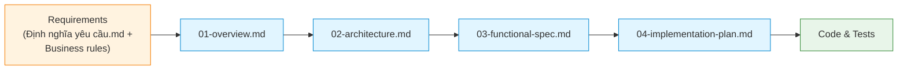

# Chima Customs B2 — System Specification

> **Entry point for AI coding agents** (Claude Code, Cursor, GitHub Spec Kit, etc.) and human engineers.

This folder contains the complete, implementation-ready specification for the Chima Customs Gate B2 vehicle clearance management system that replaces the legacy shared-Excel workflow.

---

## How to read this spec

Read the files **in order**. Each later file assumes you've read the earlier ones.

| Order | File | Read time | What you'll learn |
|-------|------|-----------|-------------------|
| 1 | [`01-overview.md`](./01-overview.md) | 10 min | Problem, constraints, architecture direction, locked tech stack, NFRs |
| 2 | [`02-architecture.md`](./02-architecture.md) | 25 min | Logical/process/deployment views, ERD, sequence diagrams, API surface, state machines |
| 3 | [`03-functional-spec.md`](./03-functional-spec.md) | 30 min | F-01 … F-18: per-feature flow + Gherkin acceptance criteria |
| 4 | [`04-implementation-plan.md`](./04-implementation-plan.md) | 20 min | Sprints, repo layout, MAUI guidance, testing, CI/CD, DoD, ADR process |
| 5 | [`05-ui-wireframes.md`](./05-ui-wireframes.md) | 25 min | 12 page wireframes, design tokens (colors, typography), tab order, accessibility AC |

All diagrams use **Mermaid**. They render natively on GitHub, VS Code, Cursor, and Claude Code.

---

## Quick orientation

---

## What's in scope (Phase 1 MVP)

- Auth + RBAC (Admin / Operator / Supervisor)
- Master data (Processors, Yards)
- Entry-gate vehicle entry; multi-vehicle declarations
- Exit-gate plate-suffix search and exit confirmation
- KVGS confirmation workflow with parent/child color logic
- Live ledger with SignalR push
- Auto daily header (00:01) and daily summary (23:00)
- Excel export using the legacy template
- Reports (by processor, yard, hour, officer, pending)
- Backup (continuous via Litestream + on-demand snapshot) and restore
- Audit log + in-app health & log viewer

## What's out of scope (Phase 1)

- Migration of historical Excel data (separate ETL tool — Phase 2)
- Integration with the unit's internal system (REST surface designed in, implementation Phase 3)
- LPR (license plate recognition)
- Mobile / multi-site / HA

---

## Key locked decisions (from `01-overview.md § 6`)

- **UI**: .NET MAUI 8 (Windows target only for Phase 1)
- **API**: ASP.NET Core 8 Minimal API, hosted as a Windows Service on the entry-gate PC
- **DB**: SQLite (WAL) + Litestream for continuous backup
- **Auth**: JWT RS256 + local user store (BCrypt)
- **Realtime**: SignalR over LAN (polling fallback)
- **Excel**: ClosedXML, template-based fill

Any deviation requires an ADR — see `04-implementation-plan.md § 9`.

---

## Reference materials in the parent folder

- `../Định nghĩa yêu cầu.md` — original Vietnamese requirement
- `../Business rules - Hướng dẫn điền sổ B2.md` — column-by-column rules (cross-referenced by feature IDs)
- `../Mẫu sổ B2.xlsx` — Excel template used for export
- `../Mẫu sổ B2.pdf` — visual reference of the legacy form

---

## For AI coding agents — recommended workflow

See `04-implementation-plan.md § 14` for the full workflow. TL;DR:

1. Read all 4 spec files end-to-end before writing any code.
2. For each feature F-XX:
   - Branch `feat/F-XX-short-name`
   - Translate each Gherkin scenario into a failing test
   - Implement Domain → Application → Infrastructure → API → Desktop
   - Verify on the spec VM (Implementation Plan § 8)
3. Never invent endpoints, DTOs, or libraries — any deviation requires an ADR.
4. Open questions → `docs/open-questions.md`, proceed with a clearly-marked assumption.
